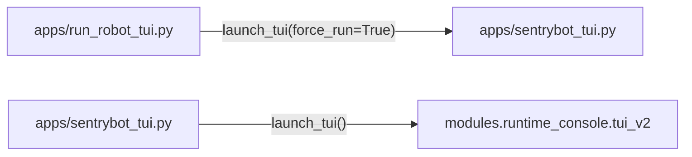

# SentryBOT Operasyon Uygulamaları (`apps/`)

Bu dizin robot ve masaüstü kontrol arayüzlerini (TUI) başlatan giriş noktalarını içerir.

## Bileşenler

- `sentrybot_tui.py`: Ortak `launch_tui(argv=None, *, force_run=False)` başlatıcısını sağlar. Gateway / modül ortamını hazırlar ve `modules.runtime_console.tui_v2` arayüzünü başlatır.
- `run_robot_tui.py`: Doğrudan robot çalıştırma TUI kısayoludur; `sentrybot_tui.launch_tui(argv, force_run=True)` çağrısını sarmalar (kod tekrarı içermez).

