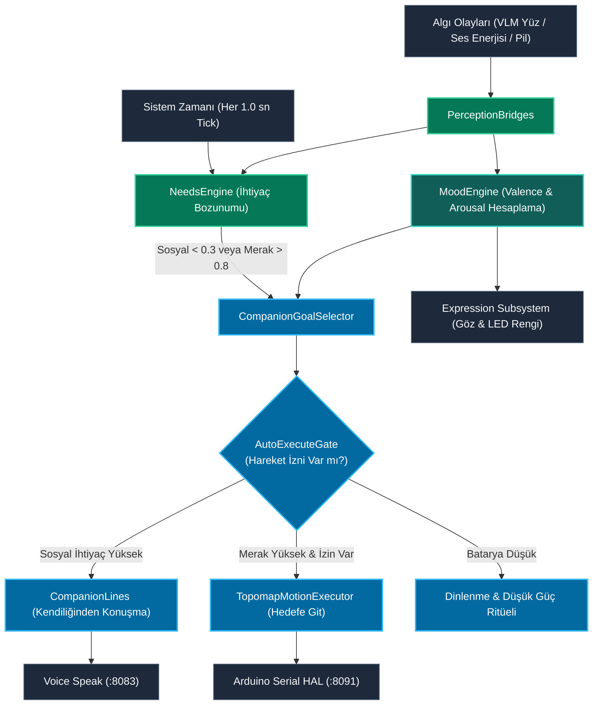
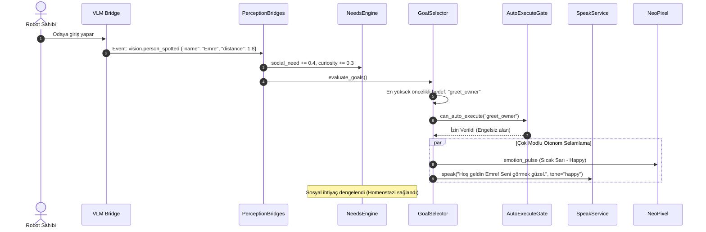

# Otonomi Modülü Mimari ve Teknik Dokümantasyonu (Autonomous Life & Companion Engine)

> **Modül:** `modules/autonomy`  
> **Kapsam:** `services/needs_engine.py`, `services/living_needs.py`, `services/mood.py`, `services/companion_goal_selector.py`, `services/behavior_composer.py`, `services/spinal_cord_reflex.py`, `services/topomap_motion_executor.py`, `services/saliency_map.py`, `services/client.py`, `api/`  
> **Tasarım Deseni:** Homeostatic Needs Drive, Thread-Safe Mood Space, Policy-Gated Companion Goal Selector, TTL Shared Perception Cache, Atomic JSON Stores  
> **Varsayılan Port:** Gateway (`:8080`) altında `/autonomy/*` olarak sunulur  
> **Temel Rol:** Kullanıcıdan bağımsız kendi kendine yaşayan, risk/güvenlik semantiği birleşik yoldaş karar & yaşam döngüsü motoru

---

## 1. Genel Bakış ve Modül Sorumlulukları

`modules/autonomy`, SentryBOT V5'in canlı bir yoldaş robot (companion robot) gibi davranmasını sağlayan otonom yaşam motorudur. `config_loader.py` modül `config/config.yml` ile `agent.yaml` paylaşım bloklarını (`llm`, `agent`, `tri_layer`, `autonomy`) ve `behaviors.idle_tree.path` (`idle_behaviors.yml`) yapılandırmasını derin birleştirme (`deep_merge`) ile yükler.

Modülün temel sorumlulukları şunlardır:

1. **İhtiyaç Motorları & Birleşik Risk/Güvenlik Semantiği (`CompanionNeedsEngine` & `LivingNeedsEngine`):**
   - `CompanionNeedsEngine` (`0..100`, yüksek = güvende) ve `LivingNeedsEngine` (`0..1`, yüksek = tehlike) artık ortak `risk` (`0..1`, yüksek = tehlike) ve `safety_level` (`0..1`, yüksek = güvende) alanlarıyla normalize edilmiş arayüz (`extract_risk_and_safety`, `normalize_unit_score`) üzerinden çalışır.
2. **Ruh Hali Yöneticisi (`MoodManager`):**
   - `RLock` korumalı `happiness`, `energy`, `curiosity`, `fear`, `anger`, `social`, `stimulation`, `rest` eksenlerini yönetir; `get_risk_and_safety()` ile risk özetini paylaşır.
3. **Kendiliğinden Hedef Seçimi & Besteleme (`CompanionGoalSelector`, `BehaviorPlanner`, `BehaviorComposer`):**
   - İhtiyaç anlık görüntüsü, `PetCompanionCore` sinyalleri ve gizlilik/sağlık/sosyal/çevre politikalarını uygular; `BehaviorPlanner`/`ReflectionPlanner` `WorldMemoryRAG.recent()` ve normalize edilmiş Ollama URL kullanır.
4. **Algı Paylaşımı & İşçi Havuzu (`PerceptionContextMixin`, `VisionMixin`, `DecisionMixin`):**
   - `get_visual_context()` ve `get_person_memory()` çağrıları kısa TTL önbelleği (`_get_cached_visual_context`, `_get_cached_person_memory`) ile aynı tick içinde paylaşılır; `step_event` ve `ReflectionPlanner` yavaş G/Ç işlemleri `_worker_executor` üzerinden `_memory_write_lock` tutulmadan yürütülür.
5. **Güvenli Otonom Hareket & Kalıcılık (`SpinalCordReflexEngine`, `TopomapMotionExecutor`, `SafeNavigationMemory`, `OwnerPersonLearning`, `CloudBackupSync`):**
   - `SpinalCordReflexEngine` hem donanım olaylarında hem Laya sesli acil durum kararlarında motor durdurmayı tetikler.
   - `TopomapMotionExecutor`, `SafeNavigationMemory` ve `OwnerPersonLearning` yolları repo köküne göre çözer ve `storage_utils.atomic_write_json` ile kilitli atomik yazım yapar (`stepper` modu varsayılan `'pos'`). `CloudBackupSync` SQLite dosyalarını `sqlite3.Connection.backup()` ile sıcak yedekler.

---

## 2. Mimari ve Veri Akış Diyagramları

### 2.1 İhtiyaç Döngüsü ve Otonom Hedef Belirleme (Mermaid Flowchart)

---

### 2.2 Algıdan Otonom Davranışa Dizi Diyagramı (Mermaid Sequence)

---

## 3. Sınıf, Fonksiyon ve Metot Seviyesi Teknik Referans

### 3.1 `CompanionNeedsEngine` (`services/needs_engine.py`) & `LivingNeedsEngine` (`services/living_needs.py`)

- `CompanionNeedsEngine.tick(...) -> dict`: `scores` (`0..100`, `safety` yüksek = güvende) ile birlikte `scale="0..100"`, `risk` (`0..1`), `safety_level` (`0..1`) ve `normalized_scores` döndürür.
- `LivingNeedsEngine.tick(...) -> dict`: `scores` (`0..1`, `safety` yüksek = tehlike) ile birlikte ortak `risk` ve `safety_level` alanlarını döndürür.
- `extract_risk_and_safety(snapshot, scores)` ve `normalize_unit_score(...)`: Politika katmanlarının iki ölçeği de tutarlı yorumlamasını sağlar.

---

### 3.2 `MoodManager` (`services/mood.py`)

- `RLock` korumalı `snapshot()`, `modify(mood, delta)`, `satisfy_need(need, amount)`, `apply_affective_event(event)`, `apply_laya_decision(decision)`, `get_risk_and_safety()`.

---

### 3.3 `CompanionGoalSelector` & `CompanionAutoExecuteGate`

- `CompanionGoalSelector.select(needs_snapshot, owner_present=False, now=None)`: `PetCompanionCore` kararları ile gizlilik, belirsizlik, kişiselleştirme, sağlık, sosyal ve öğrenme politikalarını uygular (`risk` / `safety_level` taşır).
- `CompanionAutoExecuteGate`: Cooldown ve politika izinlerine göre güvenli otomatik yürütmeyi denetler.

---

### 3.4 `SaliencyMapEngine` (`services/saliency_map.py`)

- Sahip yüzü (`1.0`), bilinmeyen yüz (`0.85`), ses yönü (`0.70 * energy`) ve hareket (`0.40`) adaylarını sıralar; kilit penceresiyle titreşimi önler.

---

## 4. REST API Endpoint Tablosu (`:8080/autonomy`)

| Metot | Uç Nokta | Açıklama | Örnek Yanıt / Parametreler |
|---|---|---|---|
| `GET` | `/autonomy/state` | Kilitli derin kopya `brain.state` ve `telemetry` (`laya_latency_ms`, `agent_latency_ms`, `worker.stalled`) | `{"is_bored": false, "telemetry": {"worker": {"stalled": false}}}` |
| `GET` | `/autonomy/mood` | Thread-safe `mood.snapshot()` | `{"happiness": 50, "energy": 100, "fear": 0}` |
| `GET` | `/autonomy/needs` | Yoldaş ihtiyaç anlık görüntüsü | `{"dominant_need": "balance", "risk": 0.0, "safety_level": 1.0}` |
| `GET` | `/autonomy/living-needs` | Homeostatik canlı ihtiyaç durumu | `{"risk": 0.0, "safety_level": 1.0, "scores": {...}}` |
| `POST` | `/autonomy/goal/simulate` | Yan etkisiz hedef simülasyonu | `{"dominant_need": "curiosity", "scores": {"curiosity": 0.8}}` |
| `POST` | `/autonomy/speech` | Final STT transkriptini otonomiye iletir | `{"text": "Merhaba", "final": true}` |
| `POST` | `/autonomy/interaction` | Fiziksel/API etkileşimi kaydeder | `{"status": "ok", "mood": 52}` |

---

## 5. Konfigürasyon Referansı (`config/config.yml` & `agent.yaml`)

- Tek birleştirilmiş `owner:` bloğu (takma adlar, RFID ve varlık zaman aşımı).
- `environment_policy.signals.safety: [risk, scores.safety, needs.safety]`.
- `config_loader.py` üzerinden `agent.yaml` (`llm`, `agent`, `tri_layer`, `autonomy`) ve `behaviors.idle_tree.path` (`idle_behaviors.yml`) derin birleştirme (`deep_merge`).
