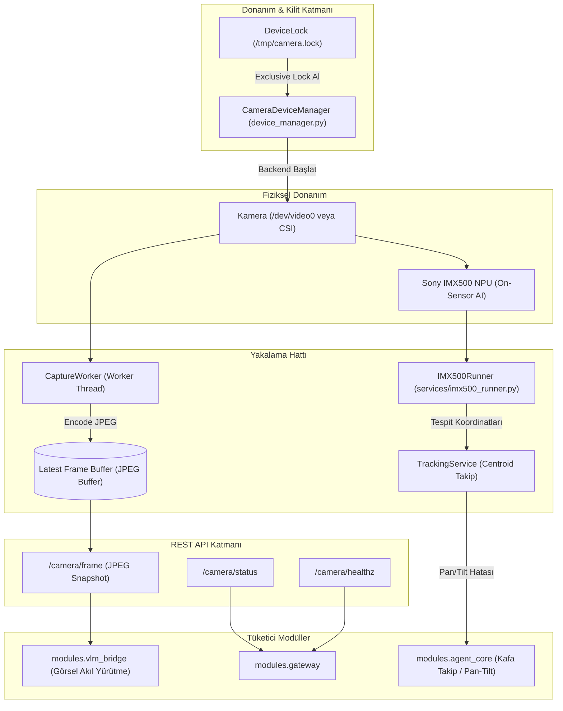
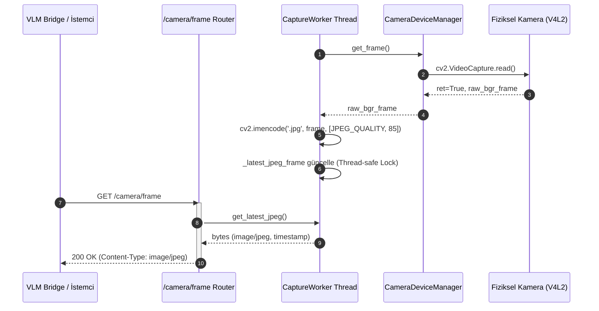

# modules.camera — Mimari ve Teknik Dokümantasyon

> **SentryBOT V5 Görüntü Yakalama, Donanım Yönetimi ve Yapay Zeka Sensör Motoru**  
> Graphviz Kaynak Dosyası: [architecture_camera.dot](file:///c:/Users/emohi/Desktop/Project%20SentryBOT%20V5/modules/camera/architecture_camera.dot)  
> SVG Diyagramı: [architecture_camera.svg](file:///c:/Users/emohi/Desktop/Project%20SentryBOT%20V5/modules/camera/architecture_camera.svg)

---

## 1. Genel Bakış ve Sorumluluklar

`modules.camera`, SentryBOT'un fiziksel dünyayı görmesini sağlayan birincil optik girdi katmanıdır. USB web kameraları, Raspberry Pi Camera v2/v3 ve Raspberry Pi AI Camera (Sony IMX500) donanımlarını otomatik tespit eder; tekil süreç kilidi (`DeviceLock`) ile donanım çakışmalarını önler; kareleri JPEG olarak tamponlar ve REST API üzerinden diğer modüllere sunar.

### Temel Sorumluluk Alanları
1. **Donanım Sahipliği ve Kilitleme (`CameraDeviceManager`):** `attach_capture()` ile gerçek yakalama hattı yaşam döngüsüne bağlanır, referans sayımı ve birleşik `RLock` altında mod geçişlerini yönetir.
2. **Süreçler Arası Kilit Mekanizması (`DeviceLock`):** Aynı kamera donanımına birden fazla tüketici çakışmasını önler.
3. **Kare Yakalama Döngüsü (`CameraCapture` + `FramePublisher`):** `Picamera2` doğrudan, sistem `picamera2` köprü alt süreci (`stderr` drain thread + EOF/üst-boyut doğrulamalı) ve OpenCV V4L2 akışlarını yürütür. `FramePublisher.set_raw_frame()` ve `threading.Condition` abone bildirimi sayesinde HTTP/VLM tüketicisi yokken boşuna JPEG sıkıştırması yapılmaz.
4. **On-Sensor AI Hızlandırması (`Imx500Runner`):** Raspberry Pi AI Camera (Sony IMX500) NPU çıktılarını kilit korumalı sayaç ve boyut-kontrollü tensör açımıyla `OnSensorEventBus`'a yayınlar; `enabled=False` iken tamamen atıl kalır.
5. **Görsel Takip Servisi (`DetectionTracker`):** IoU tabanlı takip ve kilit korumalı hedef seçimi (`largest`/`center`/`confidence`) sunar.
6. **HTTP API ve Lifespan (`api/router.py` & `xCameraService.py`):** `/camera/video`, `/camera/snap`, `/camera/status`, `/camera/healthz`, `/camera/start|stop`, `/camera/onsensor/latest` ve `/camera/tracking/*` uçlarını sunar; FastAPI `lifespan` kapanışında runner ve capture temiz biçimde durdurulur.

---

## 2. Mimari ve Veri Akış Şemaları

### 2.1 Kamera Veri Akış Şeması (Flowchart)

### 2.2 Kare Yakalama ve İstek Sıralaması (Sequence Diagram)

---

## 3. Bileşen Detayları ve API Sözleşmeleri

### 3.1 `CameraDeviceManager` (`modules/camera/device_manager.py`)
- `probe_devices() -> List[Dict[str, Any]]`
  - Sistemdeki `/dev/video*` aygıtlarını veya Windows indekslerini (0, 1, 2) tarar.
  - Açılabilirlik, desteklenen çözünürlükler ve piksel formatlarını tespit eder.
- `open_camera(device_index: int = 0, width: int = 640, height: int = 480, fps: int = 30) -> bool`
  - Belirtilen parametrelerle kamerayı başlatır. Başarısız olursa güvenli fallback uygular.
- `read_frame() -> Tuple[bool, np.ndarray | None]`
  - Kameradan son BGR matrisini çeker. Hata durumunda `(False, None)` döner.
- `close_camera() -> None`
  - Donanım kaynaklarını serbest bırakır ve kilit dosyasını temizler.

### 3.2 `CameraCapture` & `FramePublisher` (`modules/camera/services/capture.py`)
- `start() -> bool`: `backend` (`picamera2` / `opencv`) ve geciktirilmiş `find_system_picam_python()` seçimiyle yakalamayı başlatır; köprü modunda `stderr` okuma thread'i açar.
- `stop() -> None`: Kilit korumalı şekilde yakalama thread'ini, alt süreci ve bekliyor olan MJPEG abonelerini uyandırıp durdurur.
- `FramePublisher`:
  - `set_raw_frame(raw_frame, quality)` / `set_jpeg(jpeg_bytes)`: Tembel JPEG önbelleği ve `Condition` bildirimi (`has_frame` her iki durumu yansıtır).
  - `subscriber_session()` / `acquire_subscriber()` / `release_subscriber()`: Etkin HTTP/VLM abone sayacı.
  - `get_jpeg() -> Optional[bytes]`: Yalnız talep edildiğinde JPEG encode edip kare önbelleğine alır.

### 3.3 `Imx500Runner` (`modules/camera/services/imx500_runner.py`)
- `prepare()` / `start()` / `stop()`: Yaşam döngüsü (yalnız `enabled=True` iken hazırlanır).
- `tracks()` / `target()` / `select_target()`: `DetectionTracker` kilidi altında anlık hedef/iz listesi.

### 3.4 REST API Endpointleri (`modules/camera/api/router.py`)

| Metot | Yol | Açıklama | Yanıt / Model |
|:---|:---|:---|:---|
| **`GET`** | `/camera/healthz` | Donanım ve servis sağlık kontrolü. | `{"ok": bool, "enabled": bool, "capture": ..., "imx500": ...}` |
| **`GET`** | `/camera/snap` | Son yakalanan tekil JPEG görüntüsü. | `image/jpeg` (veya `503`) |
| **`GET`** | `/camera/video` | MJPEG video akışı (`Condition` tabanlı yeni kare beklemesi). | `multipart/x-mixed-replace` |
| **`GET`** | `/camera/status` | Aktif backend, çözünürlük, abone sayısı, IMX500/onsensor durumu. | JSON status özeti |
| **`GET`** | `/camera/onsensor/latest` | Son on-sensor NPU tespit paketi. | JSON snapshot |
| **`POST`** | `/camera/start`, `/camera/stop` | Kilitli yakalama başlat/durdur. | JSON kontrol durumu |

---

## 4. Hata Yönetimi ve Edge-Case Senaryoları

| Senaryo / Edge-Case | Olası Risk | Savunma Mekanizması |
|:---|:---|:---|
| **Kamera Kablosunun Çıkması (Disconnect)** | `read_frame()` bloklanır veya süreç çöker. | `CaptureWorker` arka arkaya 5 boş kare aldığında aygıtı kapatır, 2 saniye aralıklarla otomatik yeniden bağlanma (`auto-reconnect`) dener. |
| **Aygıt Kilit Çakışması (Device Busy)** | Başka bir süreç `/dev/video0`'ı tuttuğunda kamera açılamaz. | `DeviceLock` dosya kilidi kontrol edilir; gerekirse alternatif video indeksine (`/dev/video1`) otomatik geçiş yapılır. |
| **Aşırı İstek Yükü (High Request Rate)** | Her HTTP isteğinde kameradan okuma yapılması FPS düşüşüne yol açar. | Ayrık `CaptureWorker` döngüsü bağımsız çalışır; HTTP istekleri sadece tampon bellekteki son hazır kareyi okur (sıfır ek gecikme). |
| **IMX500 Sensörünün Bulunmaması** | AI kamera modeli başlatılamaz. | `imx500_runner` fail-soft davranır; NPU devre dışı bırakılır ve sistem standart yazılımsal OpenCV pipeline'ına geçer. |

---

## 5. Modüller Arası Giriş ve Çıkışlar

- **Girişler:**
  - Fiziksel kamera optik sensör verisi
  - `config/agent.yaml` altındaki `camera` ayarları (çözünürlük, fps, aygıt yolu)
- **Çıkışlar:**
  - `modules.vlm_bridge`: Çok modlu görsel akıl yürütme için son JPEG kareleri
  - `modules.agent_core`: Centroid hedef takip koordinatları (`pan_error`, `tilt_error`)
  - `modules.gateway`: Sistem izleme ve web paneli için canlı görüntü akışı
