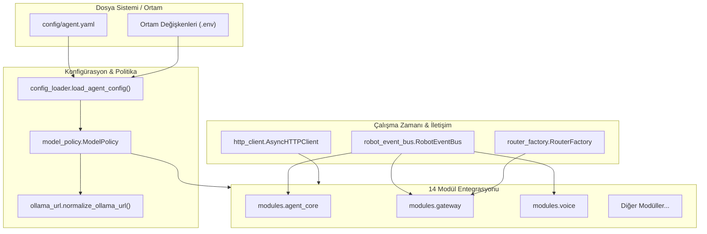
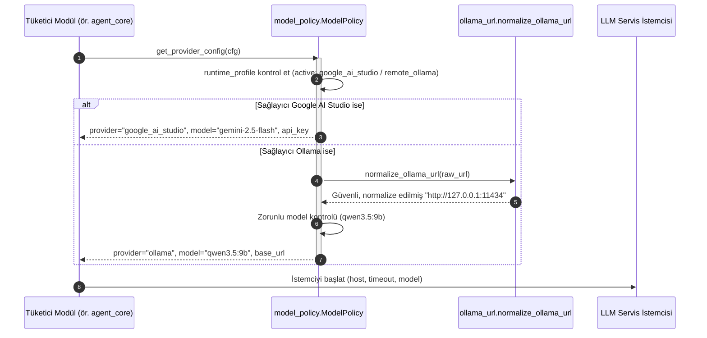

# modules.common — Mimari ve Teknik Dokümantasyon

> **SentryBOT V5 Çekirdek Altyapı ve Ortak Servisler Kütüphanesi**  
> Graphviz Kaynak Dosyası: [architecture_common.dot](file:///c:/Users/emohi/Desktop/Project%20SentryBOT%20V5/modules/common/architecture_common.dot)  
> SVG Diyagramı: [architecture_common.svg](file:///c:/Users/emohi/Desktop/Project%20SentryBOT%20V5/modules/common/architecture_common.svg)

---

## 1. Genel Bakış ve Sorumluluklar

`modules.common`, SentryBOT platformundaki tüm 14 modülün ortak olarak kullandığı temel soyutlama, konfigürasyon, model yönetim politikası, thread-safe olay dağıtımı (event bus) ve HTTP/FastAPI altyapısını sağlayan kütüphanedir. Bu modül bağımsız bir HTTP daemon olarak çalışmaz; tüm modüllerin içine kütüphane seviyesinde entegre edilir.

### Temel Sorumluluk Alanları
1. **Konfigürasyon Yönetimi (`config_loader`):** `agent.yaml` ve modül özelindeki konfigürasyonları yükleme (`load_agent_config`, `load_ai_provider_config`), `ai_provider` / `ollama_service` bölüm desteği, `llm.single_model_mode` / `llm.required_model` doğrulaması ve `deep_merge`.
2. **Model Politikası (`model_policy`):** Yerel Ollama varsayılanlarını (`LOCAL_MODEL`), sıkı/esnek tek-model modlarını (`set_strict_single_model`, `set_required_model`) ve thread-safe Singleton erişimini (`threading.Lock`) yönetir.
3. **Ollama URL Sanitizasyonu (`ollama_url`):** `DEFAULT_LOCAL_OLLAMA_URL` / `DEFAULT_REMOTE_OLLAMA_URL` sabitleri, gateway döngüsel istek engelleme (`is_bad_ollama_url`) ve ortam değişkeni tohumlama (`ensure_ollama_host_env`).
4. **Loglama ve Donanım Basıncı (`logger`, `runtime_target`):** `register_log_provider(...)` kancasıyla opsiyonel UI/logwrapper entegrasyonu; `read_hardware_pressure()` ile `/sys` ve `/proc/meminfo` üzerinden subprocess kullanmadan CPU sıcaklığı & RAM durumu okuma.
5. **Hata Toleranslı HTTP İstemcisi (`http_client`):** `AsyncHTTPClient` ve `SyncHTTPClient`, per-segment gateway circuit-breaker (`CircuitBreaker`, monotonic saat), otomatik retry (`RetryPolicy`) ve non-429 4xx izolasyonu.
6. **Standart Router, Sağlık ve Servis Tabanı (`router_factory`, `health`, `service_base`):** `RouterFactory` / `create_router` / `create_crud_router`, kayan pencereli `RateLimitMiddleware`, `HealthResponse.ok` & idempotent `HealthChecker.run()`, `ServiceBase`, `AsyncServiceBase` ve factory tabanlı `BackgroundTaskMixin`.
7. **Kalıcılık, İşler, Komutlar ve Hazırlık (`persistence`, `job_types`, `command_registry`, `vision_availability`, `model_asset_truth`):** SQLite `GLOB` ve thread-safe atomik `JSONBackend`, thread-safe `JobRegistry` (`StateSetHandler.set_value`, oturum paylaşımlı `HTTPJobHandler`), paylaşımlı `_GatewayHTTPCommandHandler`, `requests.Session` + TTL önbellekli görüş erişilebilirliği ve `config/model_assets.json` ile senkronize varlık doğrulama.

---

## 2. Mimari ve Veri Akış Şemaları

### 2.1 Bileşen İçi Veri Akışı (Flowchart)

### 2.2 Model Politikası ve İstemci Çözümleme Sırası (Sequence Diagram)

---

## 3. Bileşen Detayları ve API Sözleşmeleri

### 3.1 `modules/common/config_loader.py`
Konfigürasyonların güvenli okunmasını ve harmanlanmasını sağlar.

- `load_agent_config(path: str | Path | None = None) -> Dict[str, Any]`
  - **Parametreler:** Opsiyonel dosya yolu. Belirtilmezse `config/agent.yaml` aranır.
  - **Dönüş:** Birleştirilmiş ve doğrulanmış konfigürasyon sözlüğü.
  - **İş Mantığı:** Dosya varlığını kontrol eder, `runtime_profile` varsa aktif profili ana bölümlerin üzerine yazar (`deep_merge`). Sonuç bellekte önbelleğe alınır.
- `deep_merge(base: Dict[str, Any], update: Dict[str, Any]) -> Dict[str, Any]`
  - İç içe geçmiş sözlükleri rekürsif olarak birleştirir; anahtarlar ezilmeden yeni alanlar eklenir.
- `resolve_agent_cfg_path() -> Path`
  - Çalışma dizini, ebeveyn dizinler ve sistem yollarında `agent.yaml` dosyasını bulur.
- `load_module_config(default_path: Path, path: str | Path | None = None) -> Dict[str, Any]` / `clear_agent_config_cache()` / `redact_secrets(text)`
  - Modül yerel `config.yml` dosyalarını yükler, önbelleği temizler ve log çıktılarındaki API/Bearer anahtarlarını maskeler.

### 3.2 `modules/common/model_policy.py`
Robotun beynini oluşturan modellerin seçimini ve politika kurallarını denetler.

- `class ModelPolicy`
  - `get_model_policy()` ve `get_model_policy_async()` tekil örneği thread-safe `threading.Lock` ile başlatır.
  - `resolve_model(config)` / `get_provider_config(config)`: `set_strict_single_model(enabled)` ve `set_required_model(model_name)` ayarlarına göre aktif model ve sağlayıcı ayarlarını döner; `_resolve_ollama_base_url`, doğrulamayı `modules.common.ollama_url` (`unwrap_url`, `is_bad_ollama_url`) yardımıyla yapar.

### 3.3 `modules/common/ollama_url.py`
Ollama REST bağlantı adreslerini filtreler ve güvene alır.

- `DEFAULT_LOCAL_OLLAMA_URL` (`http://127.0.0.1:11434`) ve `DEFAULT_REMOTE_OLLAMA_URL` (`http://whoismrsentry.local:11434`) sabitlerini tanımlar.
- `normalize_ollama_url(value: Any) -> str`
  - Markdown link formatlarını (`[url](url)`), gereksiz boşlukları ve sondaki `/` karakterlerini temizler; bozuk/gateway adreslerini `default_ollama_base_url()` adresine çeker.
- `ensure_ollama_host_env()` / `ensure_sentrybot_ollama_host_env()`: Ortam değişkenlerini paylaşımlı `_seed_ollama_host_env()` yardımcısıyla doldurur.

### 3.4 `modules/common/logger.py` & `modules/common/runtime_target.py`
- `logger.py`: `register_log_provider(init_fn=..., memory_handler_fn=..., router_fn=...)` ile `modules.runtime_console` katmanına sert bağımlılık olmadan opsiyonel logwrapper kancalarını kaydeder; kanca yoksa stdlib `logging` ile çalışır.
- `runtime_target.py`: `read_hardware_pressure()` ile `/sys/class/thermal/thermal_zone0/temp` ve `/proc/meminfo` okuyarak subprocess başlatmadan `cpu_temp_c`, `mem_available_mb`, `pressure_level` (`normal`/`warm`/`critical`) ve `eco_recommended` döner; `status()` içine `"pressure"` olarak ekler.

### 3.5 `modules/common/http_client.py` & `modules/common/router_factory.py`
- `class AsyncHTTPClient` / `class SyncHTTPClient`
  - `CircuitBreaker` monotonic saat (`time.monotonic()`) ve tam kilit koruması (`threading.Lock`) kullanır; göreli gateway yollarını ilk segment bazında izole eder (`127.0.0.1:8080/speech`, `/camera`); 429 hariç 4xx yanıtlarında devre kesiciyi tetiklemez; `close_all_clients()` kilidi tutup `await` yapmadan tüm istemcileri kapatır.
- `class RouterFactory` / `create_router` / `create_crud_router` / `RateLimitMiddleware`
  - Pydantic v2 `Field(default_factory=...)`, kayan pencere (`time.monotonic()`) tabanlı per-IP `RateLimitMiddleware` (limit aşımında HTTP 429), `deprecated` route iletimi ve senkron/asenkron `health_check_fn` desteği sunar.

---

## 4. Hata Yönetimi ve Edge-Case Senaryoları

| Senaryo / Edge-Case | Olası Risk | Common Modülü Savunma Mekanizması |
|:---|:---|:---|
| **Eksik veya Hatalı `agent.yaml`** | Servis başlatılamaz ve çökebilir. | `config_loader` dahili `_DEFAULT_CFG` sözlüğüyle ayağa kalkar; `ai_provider` ve `ollama_service` bölümlerini destekler. |
| **Döngüsel Gateway URL Tanımı** | Ollama yerine Gateway'e istek atılarak sonsuz döngüye girilir. | `ollama_url.is_bad_ollama_url()`, `:8080` ve `@gateway` adreslerini tespit edip yerel Ollama varsayılanına yönlendirir. |
| **Tek Modül Hata Dalgası (4xx / Segment Isolation)** | Tek gateway alt uç noktası veya 404 yanıtı tüm devre kesiciyi açar. | `http_client._extract_host()` göreli yolları segment bazında anahtarlar ve 429 dışı 4xx hatalarında hata sayacını artırmaz. |
| **Çoklu Event-Loop / Thread Yarışları** | Import zamanı `asyncio.Lock()` veya timer kaydı yarışı `RuntimeError` üretir. | Kayıt defterleri (`job_types`, `command_registry`, `model_policy`) `threading.RLock`/`Lock`, `JSONBackend` atomik geçici dosya ve `ServiceBase` olay tabanlı durdurma kullanır. |

---

## 5. Modüller Arası Giriş ve Çıkışlar

- **Girişler:**
  - `config/agent.yaml`
  - `.env` ortam değişkenleri (`SENTRYBOT_OLLAMA_BASE_URL`, `GEMINI_API_KEY` vb.)
- **Çıkışlar:**
  - Tüm 14 modüle aktarılan konfigürasyon nesnesi
  - Normalize edilmiş ve doğrulanmış LLM bağlantı parametreleri
  - Global `EventBus` olay yayını kanalları (`CORE`, `AUDIO`, `VISION`, `FACE`, `MOVE`, `MEMORY`)
