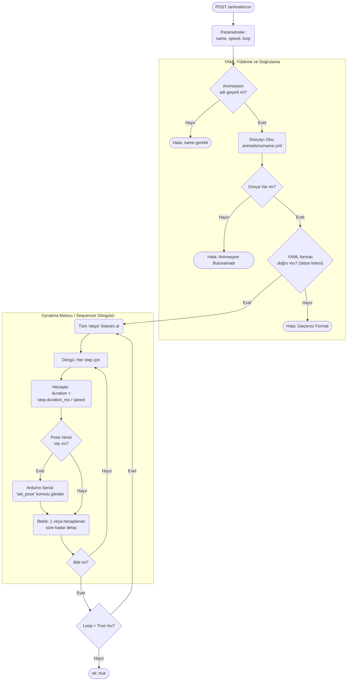
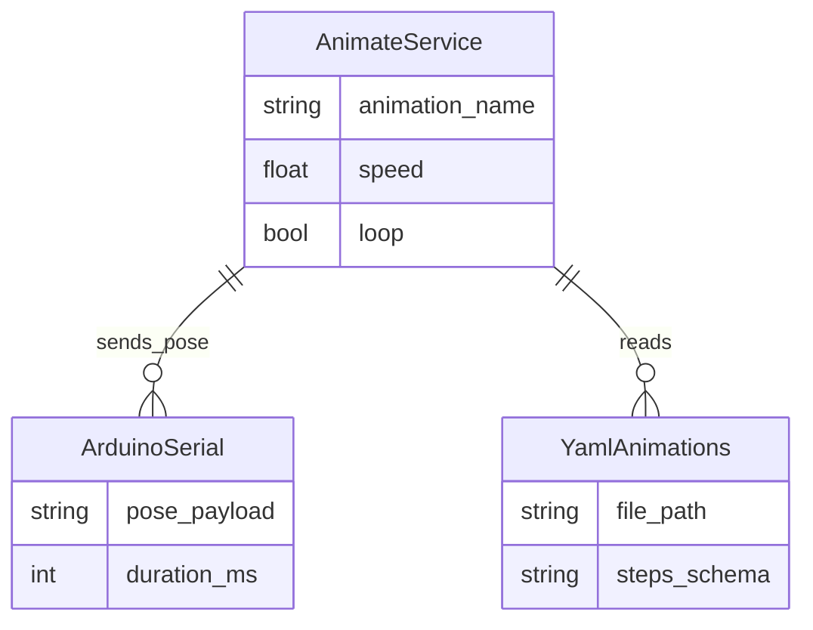

# Animate Modülü Mimarisi

Animate modülü (`modules/animate`), robotun karmaşık gövde/kafa hareketlerini (animasyonlarını) zamanlanmış servo pozisyonlarına bölen ve bunları YAML dosyalarından okuyarak Arduino'ya aktaran sıralayıcı (sequencer) motordur.

## 🏗️ İş Akışı ve Karar Mekanizmaları (Flowchart)

Bir servo animasyonunun yüklenme, hız/tempo ayarı (speed) ve Arduino'ya iletilme adım (step) if/else mantığı:

## 🔄 İlişkisel Etkileşimler (Veri Akışı)

## ⚙️ Detaylı Karar Mantığı (if/else)

1. **Güvenlik (Directory Traversal ve Çakışma Koruması)**
   - API'ye dışarıdan `name=../...` geldiğinde `_resolve_path` yol ayraçlarını ve `os.path.realpath` sınırını doğrulayıp HTTP `400` döner. Eşzamanlı çağrılarda önceki animasyon `_stop_event` ile durdurulup `_run_lock` altında seri yürütme sağlanır.
2. **Değişken Hız Katsayısı & Kesilebilir Bekleme**
   - Motor hem `duration_ms` hem `hold_ms` değerlerini `speed` çarpanıyla ölçekler ve `threading.Event.wait(...)` ile bekler; `POST /animate/stop?return_to_rest=true` ile bekleme kesilip `rest_pose`'a dönülebilir.
3. **Asenkron Yürütme & Durum İzleme**
   - `loop=true` çağrıları `start_async()` ile hemen `200` dönerken, sonlu çağrılar `run_in_threadpool` + `asyncio.wait_for(..., run_timeout_s)` ile FastAPI olay döngüsünü bloklamadan yürütülür ve `GET /animate/status` ile izlenir.
