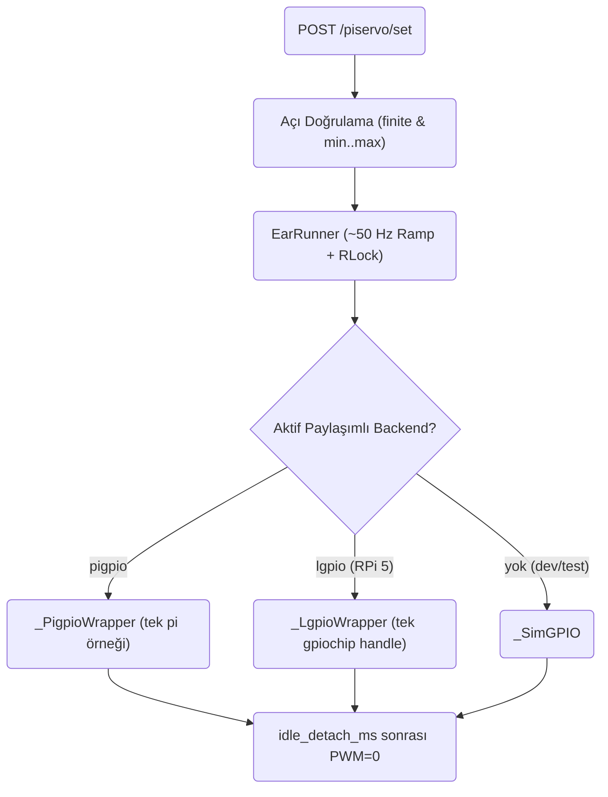
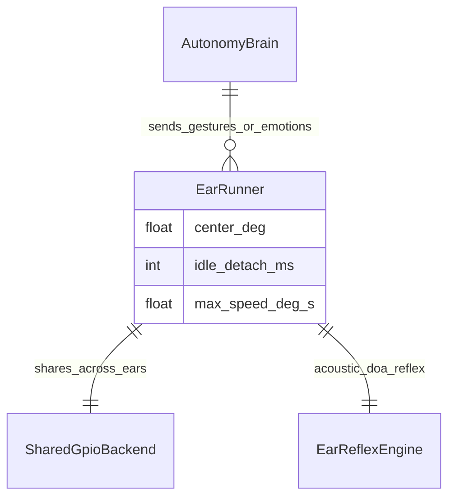

# PiServo Modülü Mimarisi

PiServo modülü (`modules/piservo`), Arduino'ya harici olarak bağlanamayan veya gövdeden bağımsız kafada (Raspberry Pi üzerinde) bulunan özel donanımları (Örn: Kulak servoları) doğrudan Pi'nin GPIO PWM pinleri üzerinden kontrol eden sınıftır.

## 🏗️ İş Akışı ve Karar Mekanizmaları (Flowchart)

## 🔄 İlişkisel Etkileşimler (Veri Akışı)

## ⚙️ Detaylı Karar Mantığı (if/else)

1. **Tek Paylaşımlı Backend & Lifespan Temizliği**
   - Sol (GPIO 12) ve sağ (GPIO 13) kulak tek bir paylaşılan `_PigpioWrapper` / `_LgpioWrapper` / `_SimGPIO` örneği kullanır. FastAPI `lifespan` kapanışında `runner.close()` tüm zamanlayıcıları durdurur, PWM'i `0` yapıp chip/pigpio tanıtıcısını kapatır.
2. **Yumuşak Ramp & `idle_detach_ms` PWM Kapatma**
   - Hedefe yumuşak ~50 Hz adım atıldıktan ve konum oturduktan `idle_detach_ms` ms sonra PWM kapatılarak SG90/MG90S servolarda vızıltı ve ısınma engellenir; bilinmeyen veya `NaN` girdiler HTTP 400 ile reddedilir.
