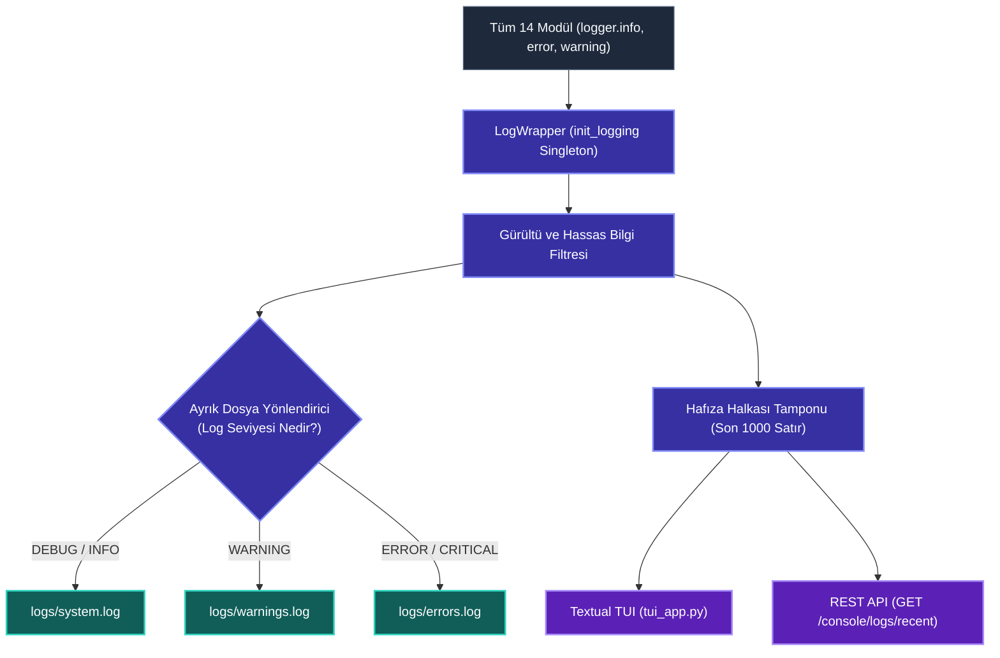
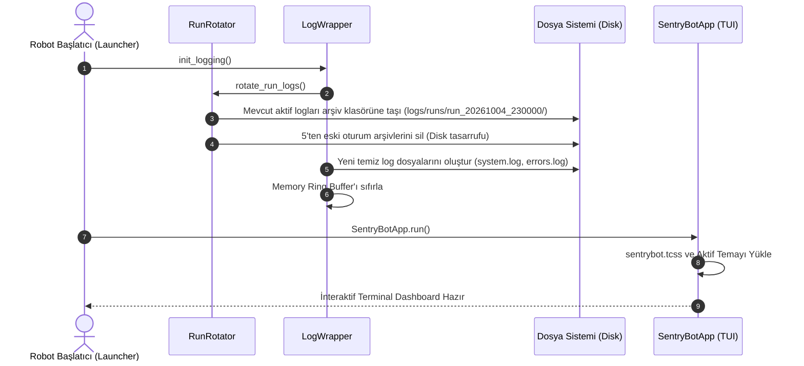

# Runtime Console Modülü Mimari ve Teknik Dokümantasyonu (TUI Dashboard & Central Logging)

> **Modül:** `modules/runtime_console`  
> **Kapsam:** `tui_app.py`, `tui_v2.py`, `logwrapper/`, `themes.py`, `system_info_tui.py`, `dashboard.py`, `renderer.py`, `widgets/`, `services/`, `api/`  
> **Tasarım Deseni:** Terminal User Interface (Textual TUI / Rich), Non-Blocking Thread/Async Pollers, Central Log Multiplexer, Run Session Rotator, Ring Buffer Memory Sink  
> **Varsayılan Port:** Gateway (`:8080`) altında `/runtime_console/*` olarak sunulur  
> **Temel Rol:** Tüm sistemin loglarını toplayan, gürültüyü süzüp dosyalara ayıran ve operatöre gerçek zamanlı asenkron terminal kontrol merkezi sunan arayüz

---

## 1. Genel Bakış ve Modül Sorumlulukları

`modules/runtime_console`, SentryBOT V5'in yerel terminal arayüzü ve tüm modüllerin kullandığı merkezi günlük kaydı (logging) altyapısıdır. Robotun çalışması esnasında oluşan yüz binlerce satırlık teknik log karmaşasını düzenler, kritik hataları (`ERROR`, `WARNING`) ayrı dosyalara ayırır ve operatörün SSH veya doğrudan monitör üzerinden robotu izlemesini sağlayan zengin bir terminal konsolu (TUI) sunar.

Modülün temel sorumlulukları şunlardır:

1. **Merkezi Günlük Altyapısı (`logwrapper` & `common.logger`):**
   - Modüllerin `from modules.common.logger import init_logging` (veya logwrapper üzerinden) ile çağırdığı tekil log yapılandırmasını yönetir.
   - **Ayrık Dosya Yönlendirmesi (`SeparateFileRouting`):** Logları önem derecesine göre otomatik olarak `logs/system.log`, `logs/warnings.log`, `logs/errors.log` ve `logs/tui.log` dosyalarına dağıtır.
   - **Oturum Döndürücüsü (`RunRotator`):** Robot her yeniden başladığında önceki oturumun loglarını arşivler (`logs/runs/run_YYYYMMDD_HHMMSS/`) ve 5'ten eski oturumları disk şişmesini önlemek için otomatik temizler (`pruning`).
2. **Textual Tabanlı İnteraktif Terminal Konsolu (`tui_app.py`):**
   - Python `Textual` ve `Rich` kütüphanelerini kullanarak modern, sekmeli ve klavyeyle kontrol edilebilir bir konsol uygulaması (`SentryBotApp`) sunar.
   - Canlı telemetri grafikleri (CPU, RAM, batarya sparkline'ları), alt sistem süreç kontrol butonları (Başlat/Durdur) ve kayan log penceresi barındırır.
3. **Dinamik Tema Motoru (`themes.py` & `sentrybot.tcss`):**
   - Dark, Cyberpunk ve Monokai gibi renk paletlerini destekler. Textual CSS (`.tcss`) kurallarını derler.
4. **Hafıza Halkası Tamponu (Memory Ring Buffer):**
   - Son 1000 log kaydını bellekte tutarak TUI ekranına ve REST API'ye anlık gecikmesiz akış sağlar.

---

## 2. Mimari ve Veri Akış Diyagramları

### 2.1 Günlük Kayıtlarının Ayrıştırılması ve TUI Akışı (Mermaid Flowchart)



---

### 2.2 Oturum Başlatma ve Günlük Döndürme Dizi Diyagramı (Mermaid Sequence)



---

## 3. Sınıf, Fonksiyon ve Metot Seviyesi Teknik Referans

### 3.1 `logwrapper/` (Merkezi Log Altyapısı)

- `init_logging(level: int = logging.INFO, run_rotation: bool = True) -> None`:
  - Kök Python `logging` yapılandırmasını kurar.
  - Tekrarlanan kütüphane loglarını (örn. `urllib3`, `PIL`, `asyncio`) filtreler.
- `RunRotator` (`services/run_rotator.py`):
  - `rotate_run_logs(logs_dir: Path, max_runs: int = 5) -> None`:
    - Çalışma dizinindeki `*.log` dosyalarını bir önceki oturum adı altında arşivler (`test_rotate_run_logs_moves_files_and_prunes_older_runs`).
- `SeparateFileRoutingHandler`:
  - `emit(record: LogRecord) -> None`:
    - Seviye bazlı dosya akışına yazar (`test_separate_warning_error_and_tui_files`).

---

### 3.2 `tui_app.py` (`SentryBotApp`) ve Async Servisler

Textual tabanlı asenkron terminal uygulaması (`--ascii`, `--no-color`, `--no-alt`, `--no-run` bayraklarını `tui_v2.py` üzerinden alır):
- **Arka Plan İşçileri ve İstemci Paylaşımı:**
  - Donanım örneklemesi (`get_cpu_info` `interval=None`, `get_memory_info`, `get_disk_info`) `asyncio.to_thread()` ile event loop dışına taşınır; yerel IP çözümü (`get_local_ip`) öncelikli olarak `psutil.net_if_addrs()` ve `socket.gethostbyname_ex` kullanır.
  - `AsyncGatewayProbe`, kalıcı tek bir `httpx.AsyncClient` yönetir (`get_client()`), gateway veya alt uç noktalar çevrimdışına düştüğünde eski telemetriyi temizler ve `/agent/decision-traces/latest?limit=5` dahil gerçek backend uç noktalarını okur; `TabControls` aynı istemciyi paylaşır ve arka plan iş parçacığından `query_one()` çağırmadan `call_from_thread()` üzerinden yazar.
  - `AsyncRobotManager`, subprocess stdout çıktısını `logs/sentry.log` yerine `logs/runtime_stdout.log` dosyasına yönlendirir (Windows üzerinde `rotate_run_logs` dosya kilidini önler) ve `restart_count` sayacını izler.
  - `AsyncLogStreamer`, disk okumasını `asyncio.to_thread()` üzerinden yapar; `TabLogs`, `collections.deque(maxlen=2000)` kullanır ve `Ctrl+S` ile filtrelenmiş logları `logs/exports/` içine dışa aktarır.
  - `MemoryExplorerModal`, gerçek `SocialDB` şemasını (`sightings`+`persons`, `owner_sessions`, `mood_snapshots`) ve `WorldMemory` sekmesini (`world_memories`, `world_observations`) `@work(thread=True)` içinde sorgular.

---

### 3.3 `themes.py` (Lazy Tema ve Stil Yöneticisi)

- Pure-data `_THEME_SPECS` ve lazy `_LazyThemeMapping` sayesinde modül import anında `textual` yüklenmez; temalar ilk erişimde oluşturulur ve `CONFIG_PATH` depo köküne sabitlenmiştir (`config/tui_theme.txt`).
- TCSS (`sentrybot.tcss`) dosyasındaki CSS değişkenlerini (`$primary`, `$secondary`, `$background`) seçilen temaya göre derler (`test_all_themes_compile_stylesheet`).

---

## 4. REST API Endpoint Tablosu (`:8080/runtime_console` & `/logs`)

| Metot | Uç Nokta | Açıklama | Güvenlik / Doğrulama |
|---|---|---|---|
| `GET` | `/runtime_console/healthz` | Konsol event bus sağlık durumu | Açık (health check) |
| `GET` | `/runtime_console/events` | Son çalışma zamanı konsol olayları (`limit` `1..200`) | Token (`X-Auth-Token` / `X-API-Key` / `Bearer`) veya yalnızca loopback |
| `GET` | `/logs/` | `InMemoryLogHandler` içindeki son log kayıtları (`n` `1..5000`) | Ring-buffer okuma |
| `POST` | `/logs/level` | Logger seviyesi güncelleme (`DEBUG..CRITICAL`) | Geçersiz seviye adlarında HTTP `400` |

---

## 5. Konfigürasyon Referansı (`agent.yaml`)

```yaml
runtime_console:
  enabled: true
  tui:
    theme: "dark_matter"
    refresh_rate_hz: 4.0
    show_sparklines: true
  logging:
    level: "INFO"
    max_history_runs: 5
    separate_error_files: true
    ring_buffer_size: 1000
```
