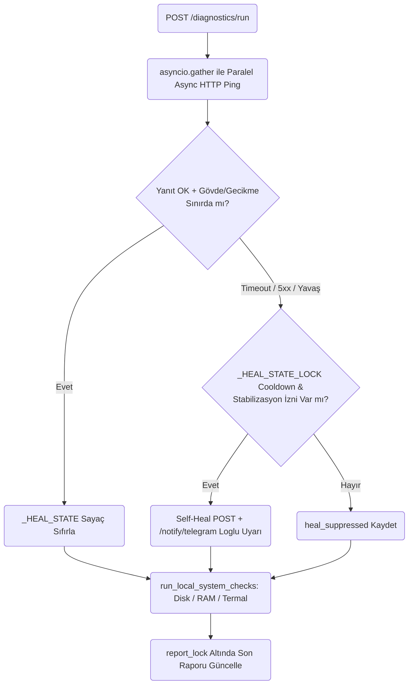

# Diagnostics Modülü Mimarisi

Diagnostics modülü (`modules/diagnostics`), robotun açılış evresinde (POST - Power On Self Test) ve çalışma sırasında periyodik olarak donanım/yazılım bileşenlerinin sağlığını test eden modüldür.

## 🏗️ İş Akışı ve Karar Mekanizmaları (Flowchart)

## ⚙️ Detaylı Karar Mantığı (if/else)

1. **Hata Yolu, Paralel Yoklama & Yerel Sistem Sağlığı**
   - `run_http_checks_async()` FastAPI event loop'unu bloklamadan `httpx.AsyncClient` + `asyncio.gather` ile tüm uçları eşzamanlı yoklar; senkron `run_http_checks()` aynı değerlendirme, stabilizasyon ve `hard_heal_cooldown_s` mantığını paylaşır.
   - Hem HTTP 5xx/gövde hataları hem bağlantı/zaman aşımı istisnaları ortak `_plan_heal` + self-heal + uyarı hattından geçer.
   - `run_local_system_checks()` `modules.common.health` (`check_disk_space`, `check_memory`) ve `runtime_target.read_hardware_pressure()` ile yerel disk, bellek ve sıcaklık baskısını rapora ekler.
