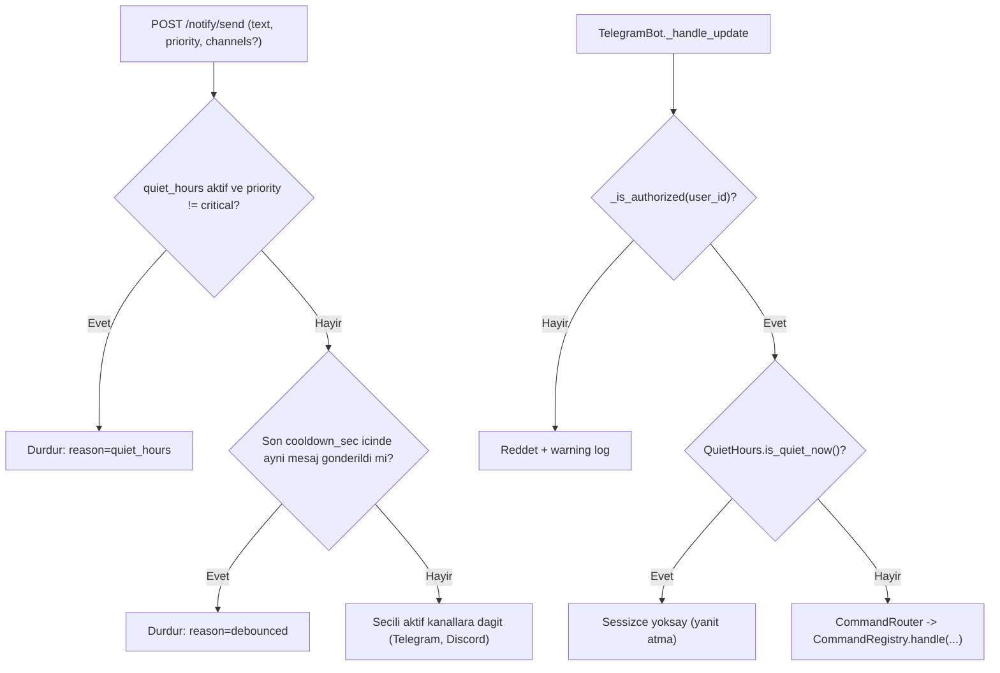
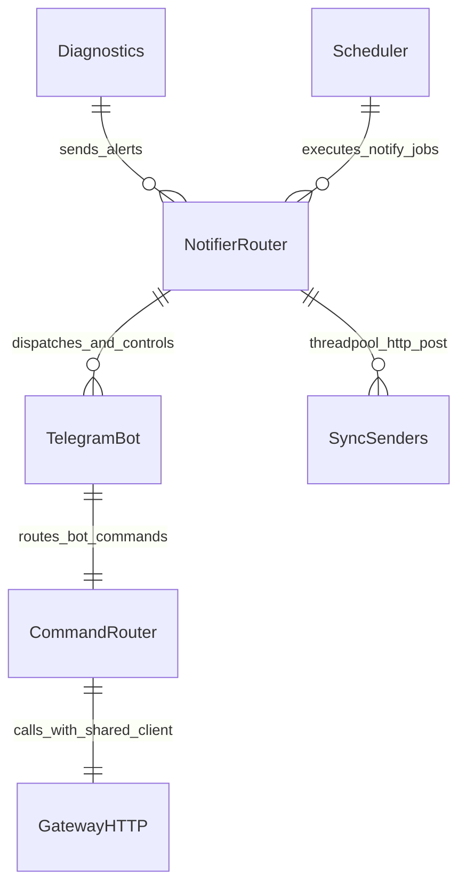

# Notifier (Bildirim) Modülü Mimarisi

Notifier modülü (`modules/system_control/notifier`), robot uyarılarını öncelik (`normal`/`critical`) ve sessiz saat (`quiet_hours`) kurallarına göre Telegram ve Discord webhook kanallarına dağıtan, ayrıca güvenli Telegram long-polling üzerinden gateway komutlarını yürüten bildirim köprü servisidir.

## İş Akışı ve Karar Mekanizmaları (Flowchart)

## İlişkisel Etkileşimler (Veri Akışı)

## Detaylı Karar Mantığı

1. **Varsayılan Reddet (`allow_public` + `allowed_user_ids`)**
   - `allowed_user_ids` boşsa `allow_public: true` açıkça ayarlanmadıkça hiçbir Telegram kullanıcısı komut yürütemez; geçersiz env ID girdileri başlangıcı çökertmeden uyarı loguyla atlanır.
2. **Ortak Sessiz Saat ve Flood Koruması**
   - `QuietHours` ve HTTP router aynı `modules.common.time_utils` (`parse_hhmm`, `is_time_in_window`) mantığını kullanır; `/notify/send` `priority="critical"` dışında tüm kanalları susturur ve başarılı gönderimler için `send.cooldown_sec` süresince aynı mesajı debounce eder.
3. **Paylaşımlı İstemci ve Sır Maskeleme**
   - `TelegramBot` tek `httpx.AsyncClient`, `senders.py` ise tek `httpx.Client` paylaşır; `xNotifierService.py` kapanışta ikisini de kapatır ve hata logları `redact_secrets` + token maskelemesiyle temizlenir.
