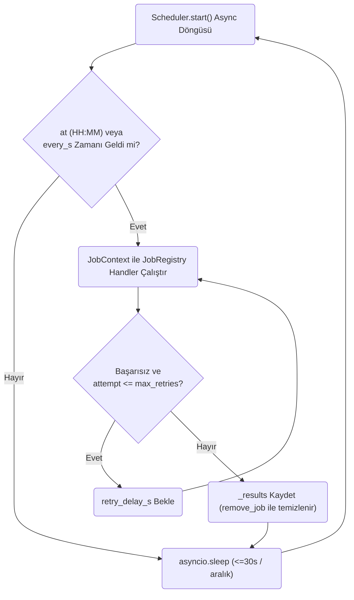

# Scheduler Modülü Mimarisi

Scheduler modülü (`modules/system_control/scheduler`), asenkron `asyncio` görev döngüleriyle periyodik (`every_s`) ve günlük saatlik (`at: "HH:MM"`) görevleri yürüten, yeniden deneme ve dinamik JSON kalıcılığı sağlayan servistir.

## 🏗️ İş Akışı ve Karar Mekanizmaları (Flowchart)

## ⚙️ Detaylı Karar Mantığı (if/else)

1. **Çalıştırma ve Yeniden Deneme (`_execute_job`)**
   - `get_job_registry()` üzerinden ilgili handler bulunur ve `JobContext(job_def, services)` ile çağrılır; hizmet bellek-içi mevcut değilse `_execute_legacy` paylaşımlı `httpx.AsyncClient` üzerinden gateway uçlarına (`/notify/telegram`, `/diagnostics/run`, `/state/set`, `/speak/say`) düşer.
2. **Günlük Saatlik Planlama (`parse_hhmm`) & Kalıcılık**
   - `at` / `schedule_time` parametresi `modules.common.time_utils.parse_hhmm` ile doğrulanır; API üzerinden eklenen/silinen dinamik işler `persistence_path` üzerinde atomik (`os.replace`) JSON olarak saklanır.
