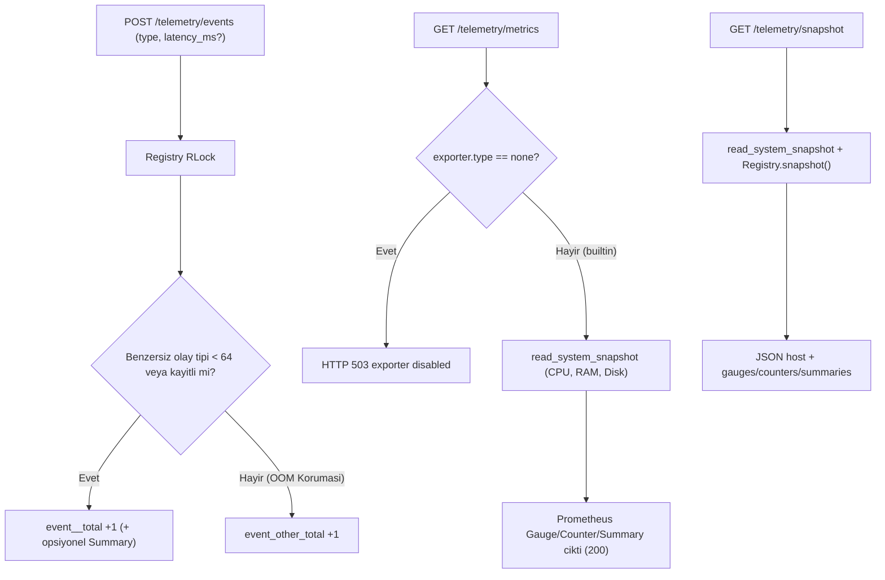
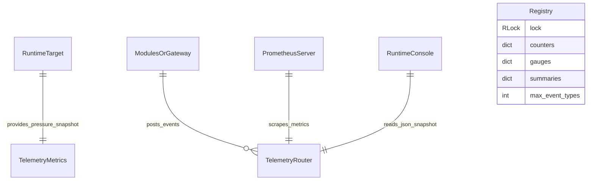

# Telemetry Modülü Mimarisi

Telemetry modülü (`modules/system_control/telemetry`), çalışma zamanı olay sayaçlarını, kayan pencereli gecikme özetlerini (`Summary`) ve Raspberry Pi 5 host durumunu (CPU sıcaklık, load, boş RAM, disk kullanımı) thread-safe `Registry` üzerinde toplayıp Prometheus (`/telemetry/metrics`) ve JSON (`/telemetry/snapshot`) olarak sunan gözlemlenebilirlik servisidir.

## İş Akışı ve Karar Mekanizmaları (Flowchart)

## İlişkisel Etkileşimler (Veri Akışı)

## Detaylı Karar Mantığı

1. **Kardinalite ve Bellek Koruması (OOM Guard)**
   - Sınırsız farklı `ev["type"]` değeri RPi 5 belleğini doldurmasın diye `Registry.record_event` en fazla 64 benzersiz olay tipini ayrı sayaç/özet olarak tutar; taşan tüm olaylar `event_other_total` altında toplanır.
2. **Thread Güvenliği (`RLock`) ve Gecikme Özeti (`Summary`)**
   - `Registry` tüm `counter`/`gauge`/`summary` ekleme, `render_prometheus()` ve `snapshot()` kopyalama işlemlerini `threading.RLock` altında yapar; `Summary` ise son 256 örneklik kayan pencerede ek kütüphanesiz `avg`, `p50`, `p95`, `max` hesaplar.
3. **Exporter Modu ve Hata Kaydı**
   - `exporter.type: none` ayarında `/telemetry/metrics` HTTP `503` döner; host ölçümü okumalarındaki istisnalar sessiz yutulmaz, `debug` seviyesinde loglanır.
