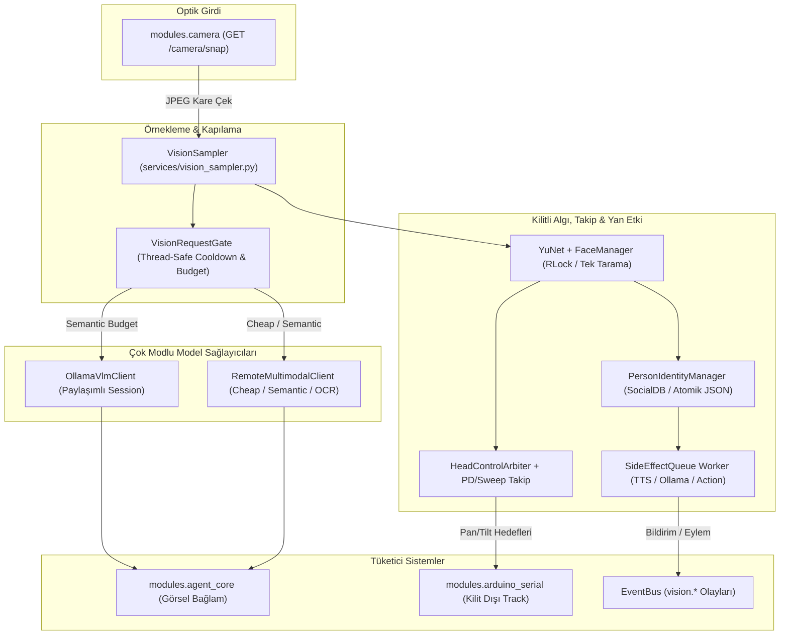
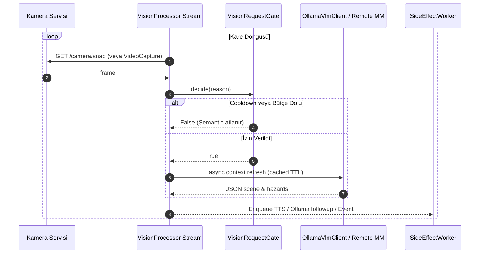

# modules.vlm_bridge — Mimari ve Teknik Dokümantasyon

> **SentryBOT V5 Görsel Dil Modeli (VLM) ve Çok Modlu Algı Köprüsü**  
> Graphviz Kaynak Dosyası: [architecture_vlm_bridge.dot](file:///c:/Users/emohi/Desktop/Project%20SentryBOT%20V5/modules/vlm_bridge/architecture_vlm_bridge.dot)  
> SVG Diyagramı: [architecture_vlm_bridge.svg](file:///c:/Users/emohi/Desktop/Project%20SentryBOT%20V5/modules/vlm_bridge/architecture_vlm_bridge.svg)

---

## 1. Genel Bakış ve Sorumluluklar

`modules.vlm_bridge`, kameradan gelen optik kareleri anlamsal sahne açıklamalarına, nesne tespitlerine (`px` + `bbox_xyxy_norm` standart şeması), insan yüz/duygularına ve kafa takip komutlarına dönüştüren çok modlu algı köprüsüdür. Yerel Ollama modellerini (`modules.common.ollama_url` ortak URL çözümlemesi ve esnek `single_model_mode`), Google Gemini desteğini ve uzak GPU sunucusunu (`remote_multimodal_server`) destekler.

### Temel Sorumluluk Alanları
1. **Görsel Örnekleme ve Kapılama (`VisionSampler`, `VisionRequestGate`):** Kareleri sahne değişikliği ve cooldown kurallarına göre süzer; kilitli (`RLock`) sayaçlarla gereksiz VLM/semantic çağrılarını önler (`vision_semantic_budget`).
2. **Yerel Yüz Tanıma & Kimlik Hafızası (`YuNetDetector`, `SFaceRecognizer`, `FaceManager`, `PersonIdentityManager`):** RLock korumalı yüz tespiti (kırpılmış ROI'de ikinci YuNet taramasını atlar) ve `SocialDB` / atomik JSON kişi hafızası yönetir.
3. **Asenkron Yan Etki & Talep Odaklı MJPEG (`VisionProcessor`):** HTTP/TTS/Ollama takip çağrılarını `_side_effect_queue` arka plan işçisinde çalıştırır; `/vlm/video_feed` JPEG kodlamasını yalnız aktif izleyici varken yapar.
4. **Kafa Yönlendirme Hakemi & PD Takip (`HeadControlArbiter`, `ProcessorFollowMixin`):** `_move_fn` HTTP çağrılarını kilit dışında paylaşımlı oturumla çalıştırır, aktif takip kaynaklarını otomatik öncelik penceresiyle korur, PD yumuşatma ve hedef kaybında sınırlı pan taraması (sweep) uygular.
5. **Güvenli Dış Sonuç Alımı & Bütçe Sözleşmesi:** `POST /vlm/results` fail-closed `hmac.compare_digest` token doğrulaması (`SENTRYBOT_VLM_AUTH_TOKEN` / `MM_AUTH_TOKEN`) ve `IngestResultsPayload` doğrulaması uygular; `InferenceBudgetManager` sözleşme uyumluluğu için korunur.

---

## 2. Mimari ve Veri Akış Şemaları

### 2.1 VLM Algı Hattı Akış Şeması (Flowchart)

### 2.2 Görsel Çıkarım Döngüsü (Sequence Diagram)

---

## 3. Bileşen Detayları ve API Sözleşmeleri

### 3.1 `VisionRequestGate` & `InferenceBudgetManager` (`services/vision_request_gate.py`, `services/inference_budget.py`)
- `VisionRequestGate.decide(reason: str)`: Hareket/sahne değişikliği debouncing'i ve `self._lock` altında sayaç takibi yapar (`vision_semantic_budget` ile koordine çalışır).
- `InferenceBudgetManager`: Geriye dönük bütçe sözleşmesi testleri için korunur.

### 3.2 `OllamaVlmClient` & `RemoteMultimodalClient` (`services/ollama_vlm_client.py`, `services/llm_client.py`)
- Ortak URL çözümlemesi `modules.common.ollama_url.normalize_ollama_url` üzerinden yapılır.
- `OllamaVlmClient` paylaşımlı `requests.Session` kullanır; `llm_client` gerçek `httpx` ortamında `_SHARED_HTTPX_CLIENT` paylaşır.
- `config_loader.py` içindeki `llm.single_model_mode` varsayılan `true` iken zorunlu modeli uygular; `false` yapıldığında farklı Ollama modelleri kabul edilir.

### 3.3 `HeadControlArbiter` & `ProcessorFollowMixin` (`services/head_control_arbiter.py`, `services/processor_follow.py`)
- `HeadControlArbiter.request_move(cmd)`: `self._lock` dışında `_move_fn(pan, tilt)` çağırır; hedef-merkezli settled deadband (`< 0.5 deg`) ve `active_speaker`/`owner_follow` için otomatik `_active_lock_ttl_s` koruması uygular.
- `ProcessorFollowMixin._drive_follow()` & `_sweep_on_target_lost()`: PD (`pd_kp`, `pd_kd`) yumuşatma ve hedef kaybında yönlü sınırlı pan taraması (`sweep_after_lost_frames`, `sweep_max_steps`, `sweep_step_deg`, `sweep_span_deg`) uygular.

### 3.4 REST API Endpointleri (`modules/vlm_bridge/api/router.py`)

| Metot | Endpoint | Açıklama | Yanıt / Güvenlik |
|:---|:---|:---|:---|
| **`GET`** | `/vlm/context/latest` | En son sahne açıklaması ve nesne listesi. | `{"available": bool, "context": dict}` |
| **`POST`** | `/vlm/context/refresh` | Güncel kare için VLM sahne bağlamını yeniler. | `{"ok": bool, "context": dict}` |
| **`GET`** | `/vlm/results/latest` | Son tespit edilen nesneler (`px` + `bbox_xyxy_norm`). | `{"results": list, "count": int}` |
| **`POST`** | `/vlm/results` | Uzak sonuçları alır (`IngestResultsPayload`). | Fail-closed `X-Auth-Token` (`hmac.compare_digest`) |
| **`POST`** | `/vlm/ask` | Anlık kare hakkında VLM'e soru sorar. | `{"ok": bool, "answer": str}` |
| **`POST`** | `/vlm/follow/start`, `/vlm/follow/stop` | Kafa takibini (`owner` dahil) başlatır/durdurur. | `{"ok": bool}` |
| **`GET`/`POST`** | `/vlm/head/status`, `/vlm/head/move` | `HeadControlArbiter` durumu ve manuel pan/tilt. | `{"ok": bool, "pan": float, "tilt": float}` |
| **`GET`/`POST`** | `/vlm/people`, `/vlm/person/*` | Kilitli kişi hafızası ve ilişki güncelleme. | `{"ok": bool, "people": list}` |
| **`GET`** | `/vlm/video_feed` | Talep odaklı (subscriber-gated) MJPEG akışı. | `multipart/x-mixed-replace` |

---

## 4. Hata Yönetimi ve Edge-Case Senaryoları

| Senaryo / Edge-Case | Olası Risk | Savunma Mekanizması |
|:---|:---|:---|
| **VLM Arka Ucunun Çökmesi (Ollama / Remote Down)** | İstek sonsuza kadar askıda kalabilir. | İstemciler zaman aşımı sınırına ve önbelleğe sahiptir; yan etkiler `_side_effect_queue` işçisinde çalıştığından ana kare/takip döngüsü kilitlenmez. |
| **Sahte `/vlm/results` Enjeksiyonu** | Boş veya `"changeme"` token ile sahte nesne gönderilmesi. | `SENTRYBOT_VLM_AUTH_TOKEN` / `MM_AUTH_TOKEN` fallback'i, placeholder reddi (401), sabit zamanlı doğrulama ve Pydantic `IngestResultsPayload` şeması zorunludur. |
| **Kare & Kafa Kilit Yarışması** | Eşzamanlı YuNet/PersonIdentity/HeadArbiter çağrıları çakışabilir. | `YuNetDetector`, `SFaceRecognizer`, `FaceManager` ve `PersonIdentityManager` `RLock` + atomik JSON `.tmp`/`replace` kullanır; `_move_fn` kilit dışında çalışır. |
| **Gereksiz VLM / JPEG Yükü** | İzleyici yokken JPEG encode veya ucuz modda ağır caption çalışabilir. | `/vlm/video_feed` yalnız `_mjpeg_subscribers > 0` iken encode yapar; uzak sunucu `_caption()` yalnız `semantic`/Qwen modunda çalışır. |

---

## 5. Modüller Arası Giriş ve Çıkışlar

- **Girişler:**
  - `modules.camera`: `/camera/snap` üzerinden çekilen anlık JPEG görüntüleri veya doğrudan `cv2.VideoCapture` + IMX500 `onsensor_hints@1`
  - `modules/vlm_bridge/config/config.yml`: Takip PD/sweep parametreleri, kapılama bütçesi, uzak multimodal uç noktaları
- **Çıkışlar:**
  - `modules.agent_core`: Çevresel sahne bağlamı (`get_latest_visual_context`)
  - `modules.arduino_serial`: Hedef takip koordinatları (`pan`, `tilt`, `HeadControlArbiter`)
  - `EventBus`: `vision.scene_changed`, `vision.person_spotted` ve kişi/duygu bildirimleri
