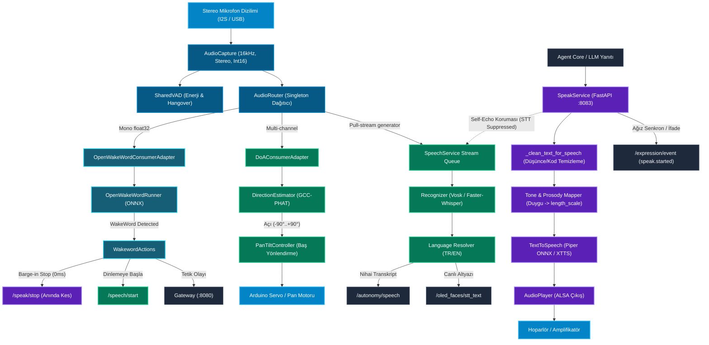
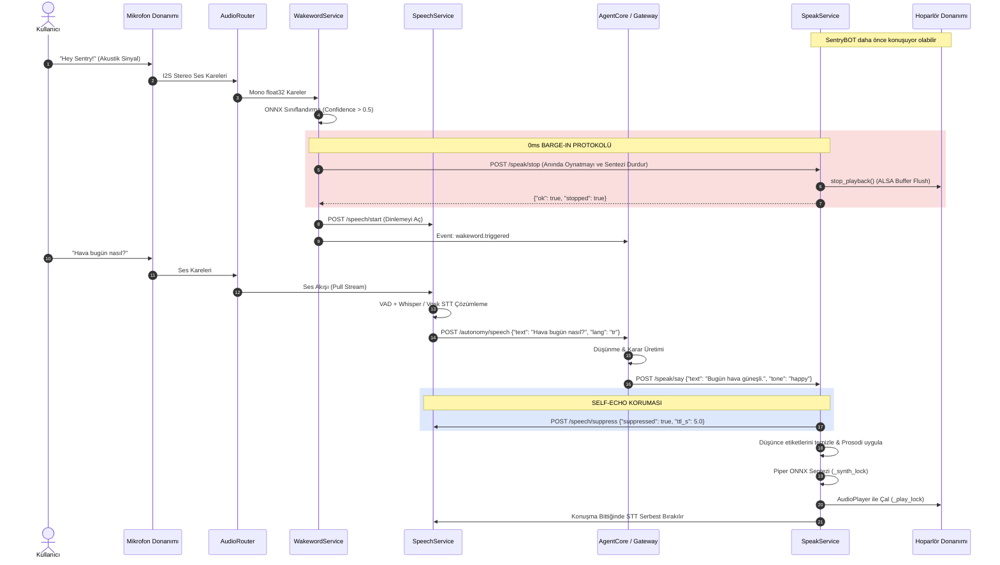

# Ses Alt Sistemi Mimari ve Teknik Dokümantasyonu (Unified Voice Architecture)

> **Modül:** `modules/voice`  
> **Kapsam:** `audio_router.py`, `modules/voice/wakeword`, `modules/voice/speech`, `modules/voice/speak`  
> **Tasarım Deseni:** Singleton Capture Multiplexer, Adapter Pattern, Split-Lock Concurrency, Non-blocking Streaming  
> **İlgili Portlar:** `8083` (Speak TTS), `8084` (Speech STT), `8085` (WakeWord)

---

## 1. Genel Bakış ve Modül Sorumlulukları

SentryBOT V5 Ses Alt Sistemi (`modules/voice`), robotun akustik dünya ile olan tüm çift yönlü (işitme ve konuşma) etkileşimini yöneten birleşik mimaridir. Linux/ALSA ortamında tek bir fiziksel ses kartına (I2S veya USB mikrofon dizilimi) birden çok alt sistemin aynı anda erişmeye çalışması durumunda ortaya çıkan **ALSA `EBUSY` kilitlenmesini ortadan kaldırmak** amacıyla merkezi bir ses yönlendirici (`AudioRouter`) üzerinde yapılandırılmıştır.

Alt sistem şu dört temel bileşenden meydana gelir:

1. **`audio_router.py` (Merkezi Yakalama ve Çoklayıcı):** Tek bir PyAudio/ALSA akışı açarak yakalanan 16 kHz stereo PCM karelerini eşzamanlı olarak WakeWord motoruna, Konuşma Tanıma (STT) motoruna ve Yön Bulma (DoA) modülüne dağıtır. Paylaşımlı Ses Aktivite Algılama (`SharedVAD`) mekanizmasını barındırır.
2. **`modules/voice/wakeword` (Uyandırma Kelimesi Dedektörü):** Sürekli ses akışını dinleyerek önceden eğitilmiş ONNX modelleriyle ("hey sentry", "sentry") düşük CPU tüketimiyle uyanma kelimesi tespit eder. Tetiklendiğinde anında **0ms Barge-In** protokolünü devreye sokar.
3. **`modules/voice/speech` (Konuşma Tanıma - STT & DoA):** Vosk veya Faster-Whisper kullanarak ses dalgalarını metne dönüştürür. Çift mikrofon kanalı arasındaki gecikmeyi (GCC-PHAT) hesaplayarak sesin geldiği açıyı (`-90°` ile `+90°`) saptar ve robotun kafasını sese doğru çevirir. Kendi konuşurken yankı yapmasını önleyen STT Bastırma Denetçisine (`STT Suppression Watchdog`) sahiptir.
4. **`modules/voice/speak` (Konuşma Sentezi - TTS & Oynatma):** Piper TTS (ONNX) ve yedek HTTP motorları (XTTS, eSpeak) ile metinleri sese dönüştürür. Düşünce/monolog temizleme filtresi (`ThoughtFilter`), duyguya göre tonlama (prosodi ayarı) ve paralel sentezleme/oynatma için **R21 Ayrık Kilit (Split-Lock)** mimarisini yürütür.

---

## 2. Mimari ve Veri Akış Diyagramları

### 2.1 Ses Dağıtımı ve Çift Yönlü İletişim Akışı (Mermaid Flowchart)



---

### 2.2 Uyanma Kelimesi -> Barge-In -> STT -> TTS Uçtan Uca Dizi Diyagramı (Mermaid Sequence)



---

## 3. Sınıf, Fonksiyon ve Metot Seviyesi Teknik Referans

### 3.1 `audio_router.py` (Merkezi Ses Dağıtıcısı)

```python
class AudioConsumer(Protocol):
    def on_audio_frame(self, frame: np.ndarray, timestamp: float) -> None: ...
    def on_start(self) -> None: ...
    def on_stop(self) -> None: ...
```

#### `AudioConfig` (Dataclass)
- `device: str = "default"`: ALSA donanım adı (`plughw:CARD=...,DEV=...`).
- `sample_rate: int = 16000`: Yakalama frekansı (Tüm modeller 16 kHz bekler).
- `channels: int = 2`: Giriş kanal sayısı (DoA gecikme hesabı için en az stereo gerekir).
- `frame_size: int = 1024`: Tampon başına düşen kare sayısı.
- `format: str = "int16"`: Örnekleme veri formatı (`int16` veya `float32`).
- `vad_enabled: bool = True`: Yerleşik paylaşımlı VAD aktifliği.
- `vad_threshold: float = 0.01`: Enerji eşiği katsayısı.

#### `SharedVAD`
- `process(frame: np.ndarray) -> bool`:
  - **İş Mantığı:** Giriş ses karesinin mutlak değer ortalamasını (`mean(abs(frame))`) hesaplar. Eşik değer aşıldığında `_is_speaking = True` yapar ve son ses zamanını (`_last_voice_time`) günceller.
  - **Hangover (Sönümleme):** Ses kesildikten sonra 500 ms boyunca `_is_speaking` durumunu `True` tutarak kelime arası duraklamalarda STT kesintilerini önler.

#### `AudioCapture`
- `register_consumer(name: str, consumer: AudioConsumer, callback: Optional[Callable] = None) -> None`: Yeni dinleyici ekler.
- `unregister_consumer(name: str) -> bool`: Dinleyiciyi çıkarır.
- `start() -> bool`: `alsaaudio`, `PyAudio` ve `sounddevice` arka uçlarıyla yakalamayı başlatır; RT callback yalnızca lock-free `_raw_queue` kuyruğuna ham bayt yazar, VAD/RMS ve tüketici dağıtımı ayrı `_dispatch_loop` işçisinde çalışır.
- `stop() -> None`: Yakalamayı durdurur, worker thread'i `join()` eder ve kayıtlı tüketicilere `consumer.on_stop()` gönderir.
- `stream(maxsize: int = 64, stop_event: Optional[threading.Event] = None) -> Generator[bytes, None, None]`:
  - **Kuyruk Tipi:** Pull-style sınırlı kuyruk (`queue.Queue(maxsize=64)`).
  - **Kesilebilir Kapanış:** `stop_event` set edildiğinde en fazla 50 ms içinde sonlanır (`wakeword`/`speech` kapanışında abone sızıntısı önlenir).

#### `AudioRouter` (Singleton)
- `get_audio_router(config: Optional[AudioRouterConfig] = None) -> AudioRouter`: Global singleton örneğini döner; `load_audio_router_config()` (`sample_rate` ve `samplerate` uyumlu) merkezi `agent.yaml` ayarını okur.

---

### 3.2 `modules/voice/wakeword` (Uyandırma Kelimesi)

#### `WakewordService` (`xWakewordService.py`)
- `start() -> None`: `AudioRouter` akışını `_gated_stream` (hafif RMS/SharedVAD enerji kapısı + hangover) üzerinden geçirip yalnızca akustik aktivite varken `OpenWakewordRunner` çıkarımına besler; hata sonrası `_listening = False` temizlendikten sonra `_stop_event.wait(delay)` ile kesilebilir yeniden başlatma yapar.
- `stop() -> None`: `_stop_event.set()` ile akışı hemen keser ve dinleyici thread'ini `join()` eder.
- `_on_wakeword(label: str) -> None`:
  - **Debounce:** İki tetiklenme arasında yapılandırılabilir `cooldown_sec` geçmesi şartı aranır.
  - **Eylemler:** `WakewordActions` (paylaşımlı `requests.Session` + `dict`/nesne uyumlu `has_final_speech()`) ile TTS durdurma, agent interrupt ve STT penceresi açma tetiklenir.

#### `OpenWakewordRunner` (`services/openwakeword_runner.py`)
- ONNX/TFLite modellerini yükler (`openwakeword_assets`: timeout'lu atomik `.tmp` + `os.replace` tek-konum indirme, `SENTRYBOT_NO_HARDWARE=1` iken temiz `None` dönüşü).
- `openwakeword_calibration.py`: temiz `sample_width` destekli `_parse_audio`, skor yumuşatma ve otomatik eşik kalibrasyonu yapar.

---

### 3.3 `modules/voice/speech` (STT & Yön Tespiti)

#### `SpeechService` (`xSpeechService.py`)
- `attach_speak_service(speak_service) -> bool`: `SpeakService.register_playback_listener()` üzerinden TTS oynatma durumunu `SoftwareEchoGate` (`set_tts_playback_state`) ile otomatik bağlar.
- `start()` / `stop()`: `capture.stream(stop_event=self._stop_event)` ile anında kapanır, thread'i `join()` eder; `stt_status()` tüm yapılandırılmış `language_models` dillerini raporlar.
- `SpeechAudioFilterMixin`: `direction.enabled=false` iken bile RMS/VU, downmix, kazanç, `SoftwareEchoGate` ve `_append_utterance_pcm()` ön işlemesini her zaman yürütür.
- `finalize_stt(text, language=None, already_transcribed=False)`: `Recognizer` çıktısı zaten çözümlenmişse ikinci kez Google STT çağırmadan `SpeakerId` ipucunu ekler ve segment tamponunu temizler.

#### `Recognizer` & `DynamicTurnTakingEngine` (`services/recognizer.py`, `turn_taking.py`)
- Tek geçişli mono (`channels=1`) giriş ve `online_stt` çok-dilli Google STT kullanır.
- `DynamicTurnTakingEngine` konuşma sonu sessizliği + enerji düşüşü (`energy_rms`) kestirimiyle segmenti sonlandırır ve tereddüt duraksamasında `on_turn_cue` üretir.
- `stt_language.py`: `_decode_pcm()` `(text, lang)` tuple ve `str` çıktılarını güvenli okur; `dual_decode_margin` karşılaştırmasını doğru uygular.

#### `DirectionEstimator` & `PanTiltController` (`services/direction.py`, `pan_tilt.py`, `sound_tracking.py`)
- Stereo GCC-PHAT açı tahmini (`-90°..+90°`), thread `join()`'li `PanTiltController.stop()` ve paylaşımlı `Session` + `min_delta_deg` filtreli `_send_pan()` sağlar.
- `PanTiltController` bu açıyı yumuşatarak baş motorlarına servo açısı olarak iletir.

---

### 3.4 `modules/voice/speak` (TTS & Oynatma)

#### `SpeakService` (`xSpeakService.py`)
- `speak(text: str, engine: Optional[str] = None, tone: Optional[str | dict] = None, speaker_wav: Optional[str] = None, language: Optional[str] = None, trace_id: Optional[str] = None) -> Dict[str, Any]`:
  - Metni temizler (`_clean_text_for_speech`).
  - Ton parametresini Piper prosodi parametrelerine çevirir (`_tone_to_piper`).
  - **R21 Split-Lock:** Sentezleme `_synth_lock` altında, hoparlörden çalma ise `AudioPlayer` örneğinin kendi `_play_lock` kilidi altında yürütülür. `@gateway/...` expression URL'i canlı gateway portuna göre çözümlenip asenkron bildirilir.
- `stop()` / `stop_speaking() -> Dict[str, Any]`:
  - Birleşik barge-in durdurma: `cancel_synthesis()` bayrağını yükseltir, kilitsiz `AudioPlayer.stop_playback()` ile (`_play_lock` beklemeden `_play_stop.set()` + `sd.stop()`) oynatmayı keser ve `speak.finished (interrupted=True)` olayını yayımlar.
- `_clean_text_for_speech(text: str) -> str`:
  - ```` ```code``` ```` bloklarını, backtick'leri ve markdown yıldızlarını temizler; LLM düşünce bloklarını filtreler.
- `/speak/say_stream` (`api/router.py`): Tek işçili sıralı `SpeechPriorityQueue` çalışanı ile akış parçalarını çalar ve üst `trace_id` izini yalnızca akış bitince kapatır.

#### `TextToSpeech` & `LanguageDetector` (`services/tts.py`, `lang_detect.py`)
- **Piper / Remote / XTTS:** Yerel ONNX `PersistentPiperModel`, `RemoteTTSHttpBackend` ve `XTTSHttpBackend` (paylaşımlı `requests.Session`); uzak motor hata verirse önbellekli `PiperBackend`'e düşer (`synthesis_cancelled` iptali hariç).
- **LRU PCM Önbelleği:** Sık kullanılan kısa ifadeler (`pcm_cache_max_chars=80`, `pcm_cache_max_entries=24`) bellek içi `_pcm_cache` içinden tekrar sentezlenmeden döner ve `health()["pcm_cache"]` altında raporlanır.
- **Çevrimdışı Dil Algılama:** `resolve_speak_language()` ağ sondası olmadan (`1.1.1.1:53` yok) çalışır ve sayı/noktalama gibi nötr metinlerde `explicit` dili korur.
- **Dummy Fallback:** Testlerde yalnızca `SENTRYBOT_ALLOW_TEST_TTS=1` (veya `tts.allow_dummy_fallback: true`) ile etkinleşir.

---

### 3.5 `modules/voice/speaker_id` (Konuşmacı Kimliği & Füzyon)

#### `SpeakerIdService` (`xSpeakerIdService.py`)
- `VoiceprintEmbedder` (`services/voiceprint.py`): 24 kHz yukarı-örnekleme/kesme olmadan doğrudan yerel 16 kHz (`window=400`, `hop=160`, `n_fft=512`), O(N log N) FFT otokorelasyonlu F0 ve `estimate_snr_db()` kestirimi uygular; `pcm_b64_to_f32()` bozuk Base64 verisinde `ValueError` (HTTP `400`) yükseltir.
- `enroll_speaker(name, speaker_pcm, samplerate)`: `enroll_min` (varsayılan `30` sesli kare) eşiğini zorlar ve `VoiceprintStore` boyut uyumsuzluğunda güvenli sıfırlama yapar.
- `identify(speaker_pcm, samplerate)`: Tanınan konuşmacıda `snr_db >= ema_min_snr_db` (`12.0` dB), `best_sim >= ema_min_similarity` ve `margin >= ema_min_margin` koşulları sağlandığında `store.update_ema()` uygular.
- `ActiveSpeakerResolver` (`services/identity_fusion.py`): Tüm yüz/ses/RFID TTL pencerelerini `time.monotonic()` ile yönetir.
- `config_loader.py`: `config/agent.yaml` içindeki `speaker_id` bölümünü birleştirir, `store_path` yolunu depo köküne göre çözer ve `apply_bind_host(..., "SPEAKER_ID_HOST")` uygular.

---

## 4. REST API Endpoint Tablosu

### 4.1 Speak Servisi (`:8083`)

| Metot | Uç Nokta | Açıklama | İstek / Yanıt |
|---|---|---|---|
| `POST` | `/speak/say` | Metni doğrudan sentezleyip hoparlörden çalar | `{"text": "Merhaba", "tone": "happy"}` |
| `POST` | `/speak/say_stream` | Uzun metinleri cümlelere bölüp arka planda kuyruğa alır | `{"text": "...", "max_chunk_chars": 180}` |
| `POST` | `/speak/stop` | Devam eden sentezi ve oynatmayı 0 ms'de keser | Yanıt: `{"ok": true, "stopped": true}` |
| `GET` | `/speak/status` | TTS motorunun sağlık durumu ve meşguliyetini bildirir | `{"ready": true, "is_speaking": false}` |
| `POST` | `/speak/play` | Ham Base64 WAV ses verisini çalar | `{"data": "<base64_wav>"}` |
| `GET` | `/speak/jobs/{job_id}` | Asenkron akış görevinin durumunu sorgular | `{"status": "running", "done_chunks": 1}` |

### 4.2 Speech Servisi (`:8082`)

| Metot | Uç Nokta | Açıklama | İstek / Yanıt |
|---|---|---|---|
| `POST` | `/speech/start` | Ses tanımayı ve dinleme döngüsünü başlatır | Yanıt: `{"ok": true, "listening": true, "stt": {...}}` |
| `POST` | `/speech/stop` | Dinlemeyi ve arka plan iş parçacığını durdurur | Yanıt: `{"ok": true, "listening": false}` |
| `GET` | `/speech/status` | Dinleme, `stt_available` ve çoklu-dil durumu | `{"ok": true, "listening": true, "stt": {...}}` |
| `GET` | `/speech/last` | Son tanınan cümle, dil ve `voice_speaker` | `{"text": "...", "language": "tr", "final": true}` |
| `GET` | `/speech/direction` | Son hesaplanan ses geliş açısını döner | `{"ok": true, "angle": 35.2}` |
| `POST`/`GET` | `/speech/track/start`, `/stop`, `/status` | DoA tabanlı pan takibi kontrolü | `{"ok": true}` |
| `POST` | `/speech/stt/suppress` | Robot konuşurken STT'yi geçici olarak susturur | `{"enabled": true}` |

### 4.3 Wakeword Servisi (`:8084`)

| Metot | Uç Nokta | Açıklama | İstek / Yanıt |
|---|---|---|---|
| `GET` | `/wakeword/healthz` | Servis hazır olma + `energy_gate` sağlığı | `{"ok": true, "listening": true, ...}` |
| `GET` | `/wakeword/status` | Uyandırma motorunun durumu ve istatistikleri | `{"ok": true, "listening": true, "energy_gate": {...}}` |
| `POST` | `/wakeword/start` | Arka plan dinleme döngüsünü başlatır | `{"ok": true, "listening": true}` |
| `POST` | `/wakeword/stop` | Dinleme döngüsünü anında kesip thread'i bekler | `{"ok": true, "listening": false}` |

### 4.4 SpeakerId Servisi

| Metot | Uç Nokta | Açıklama | İstek / Yanıt |
|---|---|---|---|
| `POST` | `/speaker_id/enroll` | Base64 (`pcm_b64`) veya float PCM ile konuşmacı kaydı (`enroll_min` kontrolü, Pydantic 422 / geçersiz b64 400) | `{"name": "ali", "pcm_b64": "...", "samplerate": 16000}` |
| `POST` | `/speaker_id/identify` | Konuşmacı tanıma (`similarity`, `margin`, `snr_db`, `ema_updated`) | `{"ok": true, "known": true, "name": "ali"}` |
| `POST` | `/speaker_id/signal` | Yüz/ses/RFID kimlik füzyon sinyali işler | `{"modality": "face", "person_id": "ali", "confidence": 0.9}` |
| `GET` | `/speaker_id/active_identity` | Monotonik TTL tabanlı aktif kimlik çözümü | `{"ok": true, "person_id": "ali"}` |
| `GET`/`DELETE` | `/speaker_id/profiles`, `/speaker_id/forget/{person_id}` | Kayıtlı ses profillerini listeler veya siler | `{"ok": true, "profiles": [...]}` |

---

## 5. Konfigürasyon Referansı (`agent.yaml` ve `config.yml`)

```yaml
# Ortak Ses Donanımı ve Yönlendirici Ayarları
audio_router:
  capture:
    device: "default"         # ALSA ses giriş aygıtı (örn: plughw:CARD=ArrayUAC10,DEV=0)
    sample_rate: 16000        # 16000 Hz zorunlu
    channels: 2               # DoA için stereo zorunlu
    frame_size: 1024
    format: "int16"
    vad_enabled: true
    vad_threshold: 0.01

# Uyandırma Ayarları
wakeword:
  enabled: true
  engine: "openwakeword"
  words: ["hey sentry", "sentry"]
  threshold: 0.50
  debounce_sec: 2.0

# Konuşma Tanıma (STT) Ayarları
speech:
  recognition:
    engine: "faster-whisper"  # veya "vosk"
    model_size: "base"
    language: "tr"
    auto_language: true
    dual_decode_margin: 0.60
    input_gain: 1.0
  direction:
    enabled: true
    mic_distance_m: 0.06      # Mikrofonlar arası fiziksel mesafe (metre)
    sound_speed: 343.0

# Konuşma Sentezi (TTS) Ayarları
speak:
  tts:
    engine: "piper"
    language: "tr"
    voice: "tr_TR-dfki-medium"
    rate: 170
    volume: 0.90
    stream_max_chunk_chars: 180
  audio_out:
    device: "default"
  liveliness:
    enabled: true
    expression_base_url: "http://127.0.0.1:8080/expression"
```
