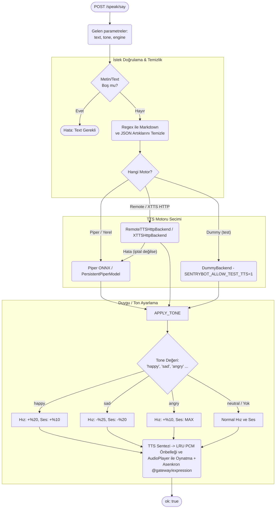
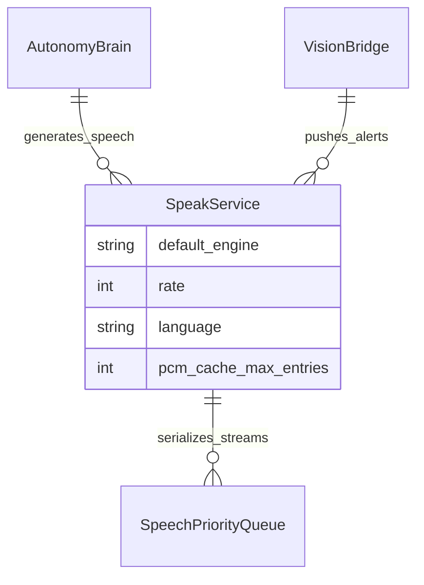

# Speak (TTS) Modülü Mimarisi

Speak modülü (`modules/speak`), metinden sese dönüştürme (Text-to-Speech) işlemini gerçekleştirerek robotun fiziksel hoparlöründen konuşmasını sağlar.

## 🏗️ İş Akışı ve Karar Mekanizmaları (Flowchart)

## 🔄 İlişkisel Etkileşimler (Veri Akışı)

## ⚙️ Detaylı Karar Mantığı

1. **Metin Temizliği & Çevrimdışı Dil Algılama (`lang_detect.py`)**
   - Autonomy'den gelen LLM cümlesi markdown, kod bloğu veya iç düşünce etiketleri (`<think>`, `reasoning:` vb.) barındırıyorsa okunmadan önce temizlenir.
   - `resolve_speak_language()` ağ sondası olmadan (`1.1.1.1:53` yok) metin dilini algılar; sayı/noktalama gibi belirsiz metinlerde `explicit` oturum dilini korur.
2. **Öncelikli Akış Kuyruğu & Kesintisiz Barge-In (`SpeechPriorityQueue` & `AudioPlayer`)**
   - `/speak/say_stream` cümleleri tek işçili sıralı `SpeechPriorityQueue` üzerinden oynatılır; yüksek öncelikli akış geldiğinde aktif konuşma anında kesilir.
   - `AudioPlayer.stop_playback()` kilitsizdir (`_play_lock` beklemeden `_play_stop.set()` ve `sd.stop()` çağırır); `stop()` ve `stop_speaking()` sentezi iptal edip `speak.finished` bildirimini asenkron yayımlar.
3. **Motor Seçimi & LRU PCM Önbelleği (`TextToSpeech`)**
   - Kısa ve sık kullanılan ifadeler (`<= 80` karakter, en fazla `24` kayıt) LRU `_pcm_cache` içinden tekrar sentezlemeden döndürülür.
   - Uzak (`remote`/`xtts`) hata verirse önbellekli yerel `PiperBackend`'e düşer; ancak kullanıcı barge-in (`synthesis_cancelled`) nedeniyle iptal edildiyse fallback tetiklenmez.
