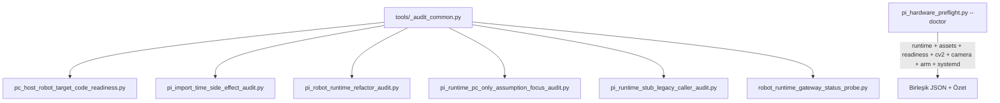

# SentryBOT Denetim, Hazırlık ve Tanılama Araçları (`tools/`)

Bu dizin donanım öncesi güvenlik kontrolleri, kod/ortam denetim araçları ve Raspberry Pi kurulum/tanılama yardımcılarını içerir.

## Ortak Mimari

## Önemli Sözleşmeler ve Komutlar

- **`tools/_audit_common.py`**: `repo_root()`, `resolve_output_paths()`, `parse_output_dir_arg()`, `rel()`, `read_text()`, `safe_json()`, `safe_yaml()`, `summarize()`, `table()`, `write_audit_reports()`, `VOICE_CONFIG_FILES`. Tüm denetim araçları varsayılan olarak `<repo_root>/reports/` dizinine yazar ve `--output-dir` parametresi alır.
- **`tools/robot_arm_control.py`**: Tüm okuyucularla uyumlu olarak `.sentrybot_state/arm_state.json` dosyasını atomik `.tmp` değişimiyle yazar; `cmd_arm()` bloklandığında sıfırdan farklı (`2`) çıkış kodu döndürür.
- **`tools/pi_v4l2_reversible_camera_probe.py`**: `probe_device()` ve `probe_device_reversible()` kamera kolunu `finally:` bloğunda serbest bırakıp güncel `released` durumuyla döner (kare yakalamaz, ağ çağrısı yapmaz).
- **`tools/robot_capability_probe.py` & `tools/robot_hardware_gap_report.py`**: Boş profil dosyası baypasını kaldırır; `/speak/status` ve `/arduino/healthz` uç noktalarını gerçek yanıt şemalarıyla doğrular.
- **`tools/companion_e2e_robot_test.py` & `tools/end_to_end_companion_scenario.py`**: Ortak `call()` yardımcısı ile `/autonomy/scenario/e2e` uç noktasını çağırır ve tüm GET + POST adımlarının başarısını kontrol eder.
- **`tools/pi_camera_imx500_live_test.py`**: `check_gateway_camera_lock(gateway_url)` ile Gateway `/camera/status` kilidini denetler ve `--fps` hız sınırlaması uygular.
- **`tools/pi_systemd_install.sh` & `tools/pi_model_downloader_layout.sh`**: Hedef `User`/`Group` değerlerini dinamik olarak yerleştirir; `DOWNLOAD_EN=1` bayrağı İngilizce Piper paketini indirir.
- **`tools/pi_hardware_preflight.py`**:
  - Varsayılan mod: `PiHardwareRuntime().status()`
  - Birleşik tanılama (`--doctor`): `collect_doctor_report(project_root, gateway_url=...)` — çalışma zamanı, model varlıkları, `pi_runtime_readiness.collect()`, `cv2` arka ucu, durum-salt okunur kamera kilidi/probu, `.sentrybot_state/arm_state.json` ve `systemd` kullanıcı hizalamasını birleştirir.
